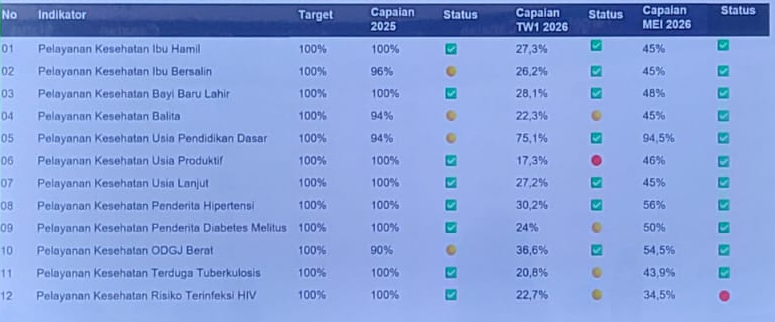

# Contoh Data — Capaian Kinerja Standar Pelayanan Minimal (SPM)

> Sumber: `Proses Bisnis Mata Sidik.xlsx` — Sheet **Contoh Data** (A1:V39)
>
> Dokumen ini adalah ekstraksi 3 dari 3 sheet. Seluruh tabel dipertahankan. Gambar dashboard yang tertanam di Excel diekstraksi ke `assets/output-dashboard-spm.png`.

## 1. OUTPUT DASHBOARD

### Persentase (Target Bulanan 8,33%)

Gambar tertanam pada rentang A5:F17 di file sumber:

Transkripsi tabel pada gambar di atas (untuk keterbacaan dan pencarian teks, format tabel dipertahankan):

| No | Indikator | Target | Capaian 2025 | Status | Capaian TW1 2026 | Status | Capaian MEI 2026 | Status |
| --- | --- | --- | --- | --- | --- | --- | --- | --- |
| 01 | Pelayanan Kesehatan Ibu Hamil | 100% | 100% | ✅ | 27,3% | ✅ | 45% | ✅ |
| 02 | Pelayanan Kesehatan Ibu Bersalin | 100% | 96% | ✅ | 26,2% | ✅ | 45% | ✅ |
| 03 | Pelayanan Kesehatan Bayi Baru Lahir | 100% | 100% | ✅ | 28,1% | ✅ | 48% | ✅ |
| 04 | Pelayanan Kesehatan Balita | 100% | 94% | 🟡 | 22,3% | 🟡 | 45% | ✅ |
| 05 | Pelayanan Kesehatan Usia Pendidikan Dasar | 100% | 94% | ✅ | 75,1% | ✅ | 94,5% | ✅ |
| 06 | Pelayanan Kesehatan Usia Produktif | 100% | 100% | ✅ | 17,3% | 🔴 | 46% | ✅ |
| 07 | Pelayanan Kesehatan Usia Lanjut | 100% | 100% | ✅ | 27,2% | ✅ | 45% | ✅ |
| 08 | Pelayanan Kesehatan Penderita Hipertensi | 100% | 100% | ✅ | 30,2% | ✅ | 56% | ✅ |
| 09 | Pelayanan Kesehatan Penderita Diabetes Melitus | 100% | 100% | ✅ | 24% | 🟡 | 50% | ✅ |
| 10 | Pelayanan Kesehatan ODGJ Berat | 100% | 90% | ✅ | 36,6% | ✅ | 54,5% | ✅ |
| 11 | Pelayanan Kesehatan Terduga Tuberkulosis | 100% | 100% | ✅ | 20,8% | ✅ | 43,9% | ✅ |
| 12 | Pelayanan Kesehatan Risiko Terinfeksi HIV | 100% | 100% | ✅ | 22,7% | 🟡 | 34,5% | 🔴 |

> Catatan: ikon Status (✅ / 🟡 / 🔴) adalah interpretasi visual dari gambar sumber. Nilai persen disalin apa adanya dari gambar.

## 2. OUTPUT DASHBOARD / LAPORAN — Data Absolut Kabupaten

Tabel sumber baris 22–35. Kolom `Status` di file sumber masih kosong. Kolom `Target Bulanan` = `Target 2026 / 12` (contoh baris 1: 2000 / 12 = 166,67). Format tabel dipertahankan.

| No. | Indikator | Target 2026 | Target Bulanan | Januari | Status | Februari | Status |
| --- | --- | --- | --- | --- | --- | --- | --- |
| 1 | Persentase pelayanan kesehatan ibu hamil sesuai standar | 2000 | 166,67 | 155 |  | 120 |  |
| 2 | Persentase pelayanan kesehatan ibu hamil sesuai standar |  |  |  |  |  |  |
| 3 | Persentase pelayanan kesehatan ibu hamil sesuai standar |  |  |  |  |  |  |
| 4 | Persentase pelayanan kesehatan balita sesuai standar |  |  |  |  |  |  |
| 5 | Persentase Pelayanan kesehatan pada usia pendidikan dasar sesuai standar |  |  |  |  |  |  |
| 6 | Persentase Pelayanan kesehatan pada usia produktif sesuai standar |  |  |  |  |  |  |
| 7 | Persentase warga negara usia 60 tahun ke atas mendapatkan pelayanan kesehatan sesuai standar |  |  |  |  |  |  |
| 8 | Persentase pelayanan kesehatan penderita hipertensi sesuai standar |  |  |  |  |  |  |
| 9 | Persentase pelayanan kesehatan penderita diabetes melitus sesuai standar |  |  |  |  |  |  |
| 10 | Persentase pelayanan kesehatan orang dengan gangguan jiwa berat sesuai standar |  |  |  |  |  |  |
| 11 | Persentase Pelayanan kesehatan orang terduga tuberkulosis sesuai standar |  |  |  |  |  |  |
| 12 | Persentase Pelayanan kesehatan orang dengan risiko terinfeksi virus Yang melemahkan daya tahan tubuh manusia (Human Immunodeficiency Virus) sesuai standar |  |  |  |  |  |  |

Detail baris contoh terisi (baris 1): Target 2026 = 2000, Target Bulanan = 166,67, Januari = 155, Februari = 120.

## 3. Data Absolut Inputan Puskesmas

Tabel sumber baris 39 (1 baris contoh). Kolom C:N merge di file sumber digabung menjadi satu kolom Keterangan.

| No. | Indikator | Keterangan / Cara Input |
| --- | --- | --- |
| 1 | Persentase pelayanan kesehatan ibu hamil sesuai standar | yang diinput Puskesmas adalah data ibu hamil yang dilayani sesuai standar BNBA, dan BNBA ini nanti sistemnya diupload dalam bentuk file excel sesuai format yg sudah dimiliki puskesmas saat ini. ** dari data ini harapannya nanti juga bisa tergambar wilayah keberadaan ibu hamil sesuai alamat domisili (dari desa, peskesmas, kecamatan) serta wilayah mana yang banyak ibu hamilnya tidak mendapat pelayanan sesuai standar |

> Isi keterangan baris 1: yang diinput Puskesmas adalah data ibu hamil yang dilayani sesuai standar BNBA, dan BNBA ini nanti sistemnya diupload dalam bentuk file excel sesuai format yg sudah dimiliki puskesmas saat ini. ** dari data ini harapannya nanti juga bisa tergambar wilayah keberadaan ibu hamil sesuai alamat domisili (dari desa, peskesmas, kecamatan) serta wilayah mana yang banyak ibu hamilnya tidak mendapat pelayanan sesuai standar

---

## Lampiran: Tabel Mentah Excel — Data Absolut Kabupaten (format asli)

Struktur header ganda di file sumber dipertahankan sebagai dua baris header berikut:

| No. | Indikator | Target 2026 | Target Bulanan | Jumlah Layanan (Januari) | Status | Jumlah Layanan (Februari) | Status |
| --- | --- | --- | --- | --- | --- | --- | --- |
|  |  |  |  | Januari | Status | Februari | Status |
| 1 | Persentase pelayanan kesehatan ibu hamil sesuai standar | 2000 | 166,67 | 155 |  | 120 |  |
| 2 | Persentase pelayanan kesehatan ibu hamil sesuai standar |  |  |  |  |  |  |
| 3 | Persentase pelayanan kesehatan ibu hamil sesuai standar |  |  |  |  |  |  |
| 4 | Persentase pelayanan kesehatan balita sesuai standar |  |  |  |  |  |  |
| 5 | Persentase Pelayanan kesehatan pada usia pendidikan dasar sesuai standar |  |  |  |  |  |  |
| 6 | Persentase Pelayanan kesehatan pada usia produktif sesuai standar |  |  |  |  |  |  |
| 7 | Persentase warga negara usia 60 tahun ke atas mendapatkan pelayanan kesehatan sesuai standar |  |  |  |  |  |  |
| 8 | Persentase pelayanan kesehatan penderita hipertensi sesuai standar |  |  |  |  |  |  |
| 9 | Persentase pelayanan kesehatan penderita diabetes melitus sesuai standar |  |  |  |  |  |  |
| 10 | Persentase pelayanan kesehatan orang dengan gangguan jiwa berat sesuai standar |  |  |  |  |  |  |
| 11 | Persentase Pelayanan kesehatan orang terduga tuberkulosis sesuai standar |  |  |  |  |  |  |
| 12 | Persentase Pelayanan kesehatan orang dengan risiko terinfeksi virus Yang melemahkan daya tahan tubuh manusia (Human Immunodeficiency Virus) sesuai standar |  |  |  |  |  |  |
