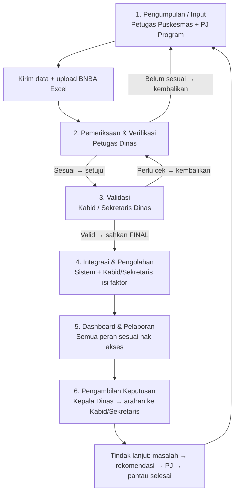
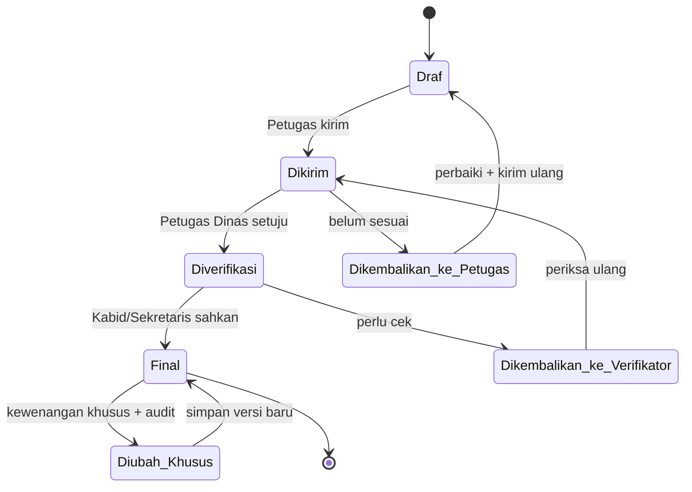
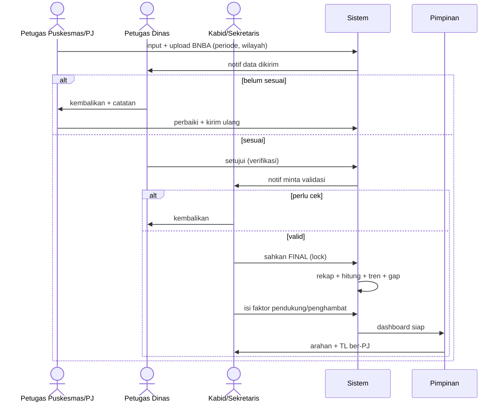
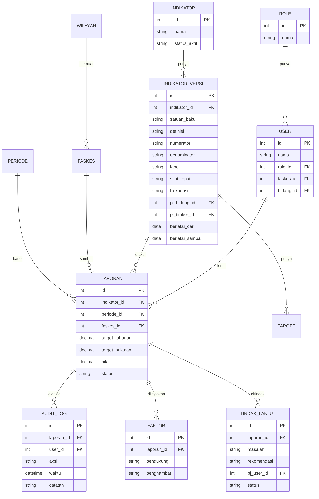

# MATA SIDIK — Manajemen Data dan Sistem Informasi Dinas Kesehatan Kab. Sumbawa Barat

> README gabungan untuk **Dinas (pengguna bisnis)** dan **Developer (pelaksana teknis)**.
> Disusun dari ekstraksi `Proses Bisnis Mata Sidik.xlsx`:
> - `01-gambaran-umum.md` — Sheet Gambaran Umum (A1:F52)
> - `02-daftar-indikator-kinerja.md` — Sheet Daftar Indikator Kinerja (A1:H62, 58 baris data)
> - `03-contoh-data.md` — Sheet Contoh Data (A1:V39) + `assets/output-dashboard-spm.png`

---

## Daftar Isi

- [Bagian A — Untuk Dinas](#bagian-a--untuk-dinas-pengguna-bisnis)
- [Bagian B — Untuk Developer](#bagian-b--untuk-developer-pelaksana-teknis)

---

# Bagian A — Untuk Dinas (Pengguna Bisnis)

## A.1 Apa itu MATA SIDIK

Aplikasi untuk mengganti rekap manual menjadi alur terstandar: Puskesmas/bidang input → Dinas memeriksa → Kabid/Sekretaris memvalidasi → sistem mengolah → pimpinan melihat dashboard dan memberi arahan → tindak lanjut dipantau.

Maksud (sumber `01-gambaran-umum.md:15-20`):

| No | Maksud |
| --- | --- |
| 1. | Pengelolaan data kesehatan yang terintegrasi dan terstandar |
| 2. | Kelengkapan, konsistensi, ketepatan waktu, keterlacakan data |
| 3. | Pemantauan indikator per program, faskes, wilayah, periode |
| 4. | Laporan cepat, tanpa rekap manual |
| 5. | Informasi strategis bagi Kepala Dinas/pimpinan |
| 6. | Fondasi analisis, integrasi, dan pemantauan tindak lanjut |

Tujuan (`01-gambaran-umum.md:26-31`): integrasi data Puskesmas/bidang/program, standarisasi format-definisi-periode-sumber, validasi sebelum dipakai, dashboard kinerja, dukung perencanaan–penganggaran–monev, riwayat perubahan + hak akses.

Ruang lingkup (`01-gambaran-umum.md:37-41`):

| No | Kelompok | Isi |
| --- | --- | --- |
| 1. | Pengelolaan Data | Sumber, kamus data, standar indikator, periode, data induk |
| 2. | Pelaporan dan validasi | Kumpul, cek kelengkapan, validasi, kembalikan yang salah, setujui |
| 3. | Pengolahan dan analisis | Rekap, hitung indikator, tren, target vs realisasi, kesenjangan |
| 4. | Penyajian informasi | Dashboard pimpinan, laporan periodik, grafik, peta (bila ada), ekspor |
| 5. | Tindak lanjut dan evaluasi | Masalah, rekomendasi, PJ, pantau penyelesaian |

## A.2 Alur bisnis + peran tiap tahap

### Tabel peran × aksi × data

| Tahap | Pelaku | Aksi | Data masuk | Data keluar / status |
| --- | --- | --- | --- | --- |
| 1. Input | Petugas Puskesmas, PJ program/indikator Dinas | Input angka + upload file BNBA Excel format Puskesmas; kirim per periode | Jumlah layanan, alamat domisili (desa/puskesmas/kecamatan), periode | Status: Draf → Dikirim |
| 2. Verifikasi | Petugas Dinas (kabupaten) | Cek kelengkapan; setujui atau kembalikan dengan catatan | Data terkirim | Status: Diverifikasi / Dikembalikan ke tahap 1 |
| 3. Validasi | Kepala Bidang / Sekretaris Dinas | Setujui final atau kembalikan ke tahap 2; perubahan data final butuh kewenangan khusus + jejak audit | Data terverifikasi | Status: Final (terkunci) / Dikembalikan ke tahap 2 |
| 4. Pengolahan | Sistem (otomatis) + Kabid/Sekretaris | Rekap, hitung indikator, tren, kesenjangan; Kabid/Sekretaris wajib isi faktor pendukung + penghambat | Data final + target | Tren capaian, gap target–realisasi |
| 5. Dashboard | Semua (sesuai hak akses) | Lihat/filter/ekspor per 9 pengelompokan (lihat A.4) | Data olahan | Grafik, tabel, laporan periodik |
| 6. Keputusan | Kepala Dinas/pimpinan → Kabid/Sekretaris | Beri arahan, tetapkan rencana TL, pantau evaluasi | Capaian + faktor + gap | Arahan, TL ber-PJ dan berstatus |

Siklus status data:

Jejak audit wajib catat (sumber `01-gambaran-umum.md:61`): **siapa** mengirim / memeriksa / menyetujui / mengubah + **kapan** (waktu tindakan). Filter status menurut faskes, bidang, program, indikator, periode.

## A.3 Contoh nyata (SPM)

Contoh `03-contoh-data.md:19-30` — target 100%, capaian 2025, TW1 2026, Mei 2026 untuk 12 indikator (Ibu Hamil s.d. Risiko HIV). Detail angka absolut (`03-contoh-data.md:40`): Target 2026 = 2000, Target Bulanan = 166,67 (`2000/12`), Januari = 155, Februari = 120.

Input Puskesmas (`03-contoh-data.md:61`): yang diinput adalah data ibu hamil dilayani sesuai standar + file BNBA; sistem diharapkan memetakan sebaran per desa/puskesmas/kecamatan dan menandai wilayah yang banyak tidak terlayani standar.

## A.4 Pengelompokan laporan (9 kategori)

`01-gambaran-umum.md:77-85`: IKU (Tujuan/Sasaran), IKK, SPM, RIBK, Program, Kegiatan, Sub Kegiatan, Bidang/Sekretariat/Tim Kerja, + 1 baris `........................` (belum defined — perlu keputusan Dinas).

Katalog indikator lengkap (58 baris, No.1–12 + tanpa nomor + `dst belum selesai`): lihat `02-daftar-indikator-kinerja.md:17-74`. Contoh terisi: UHH, Kematian Ibu/Balita, Stunting — dengan label ganda (IKU; Sasaran; IKK; RIBK; Kesmas).

## A.5 Yang perlu dilengkapi Dinas (daftar keputusan)

1. **Definisi Operasional** masih kosong semua (`02-daftar-indikator-kinerja.md:15`) — tiap indikator butuh numerator/denominator, sumber, frekuensi.
2. **Satuan** belum baku (`%` vs `Persentase` vs `(%)`, `Poin`, `Kasus`, `Dokumen`, `Rasio`) — pilih satu kosakata.
3. **Duplikasi**: 3 baris identik ibu hamil (`02-daftar-indikator-kinerja.md:29-31`) — gabung atau bedakan (TW1/Mei/absolut?).
4. **PJ Data** baru terisi 5 baris awal — tetapkan Bidang + Timker/Subbag untuk semua.
5. **Kategori ke-9** (`........................`) — definisikan atau hapus.
6. **Aturan Status** ✅🟡🔴 pada dashboard — tetapkan ambang batas (mis. ≥90% hijau).
7. **SLA**: berapa hari batas input/verifikasi/validasi per periode; siapa diingatkan bila terlambat.
8. **Format BNBA**: kunci kolom Excel Puskesmas agar upload tidak gagal.

## A.6 Catatan: file `02` adalah master dinamis (bukan laporan mati)

`02-daftar-indikator-kinerja.md:15-74` berisi 58 baris + baris `dst belum selesai` — artinya katalog masih tumbuh. Fungsinya sebagai **kamus yang mengendalikan aplikasi**: nama/satuan menentukan tampilan form, definisi menentukan rumus engine, label menentukan kelompok dashboard, sifat data menentukan siapa input dan seberapa sering, PJ menentukan routing ke bidang mana.

Konsekuensi praktis bagi Dinas: tiap tambah indikator baru wajib melengkapi 6 field (satuan baku, definisi + pembilang/penyebut, label, sifat input, frekuensi, PJ Bidang/Timker). Tanpa itu indikator tidak bisa dihitung atau dimunculkan di dashboard. Lihat detail teknis skema berversi di [B.5](#b5-skema-master-indikator-dinamis--raci-per-label).

---

# Bagian B — Untuk Developer (Pelaksana Teknis)

## B.1 Modul yang disarankan (dipetakan dari ruang lingkup)

| Modul | Fungsi | Sumber |
| --- | --- | --- |
| Master | Wilayah (desa/kec/puskesmas), Faskes, Bidang/Timker, Indikator + Label, Periode, Target | 01 §4.1, 02 katalog, 03 BNBA |
| Ingest | Input manual + upload BNBA Excel (template Puskesmas), validasi format | 01 §5.1, 03 §3 |
| Workflow | Kirim → verifikasi → validasi → final → pengembalian + notifikasi | 01 §5.2–5.3 |
| Engine | Rekap, `target_bulanan = target_tahunan/12`, capaian %, tren, gap | 03 §2 |
| Faktor & TL | Form faktor pendukung/penghambat (wajib saat olahan terbit); CRUD tindak lanjut (masalah→rekomendasi→PJ→status) | 01 §5.4, §5.6 |
| Dashboard | 9 pengelompokan + filter (faskes/bidang/program/indikator/periode/wilayah) + ekspor | 01 §5.5 |
| Audit & RBAC | Log who/when/what + penguncian data final | 01 §5.3 note |

## B.2 Sequence per peran

## B.3 Model data (usulan awal)

## B.4 Matriks hak akses (RBAC awal — selaraskan dengan Dinas)

| Aksi | Puskesmas/PJ | Verifikator Dinas | Kabid/Sekretaris | Pimpinan | Admin |
| --- | --- | --- | --- | --- | --- |
| Input/kirim + upload BNBA | ✅ | ❌ | ❌ | ❌ | ✅ (bantuan) |
| Verifikasi/kembalikan ke pengirim | ❌ | ✅ | ❌ | ❌ | ❌ |
| Validasi final/kembalikan ke verifikator | ❌ | ❌ | ✅ | ❌ | ❌ |
| Ubah data final (khusus + audit) | ❌ | ❌ | ✅ terbatas | ❌ | ✅ |
| Isi faktor pendukung/penghambat | ❌ | ❌ | ✅ wajib | ❌ | ❌ |
| Lihat dashboard semua filter | milik sendiri | bidangnya | bidangnya | ✅ semua | ✅ |
| Beri arahan / tetapkan TL | ❌ | ❌ | terima | ✅ beri | ❌ |
| Kelola master + user | ❌ | ❌ | ❌ | ❌ | ✅ |

## B.5 Skema master indikator dinamis + RACI per label

File `02` adalah master hidup (ada baris `dst belum selesai`). Aturan: tambah = versi baru, nonaktifkan = set `berlaku_sampai` + `status_aktif=false`. Jangan hapus fisik agar tren historis utuh. Setiap versi wajib isi: satuan baku, definisi + numerator/denominator, label[], sifat input, frekuensi, level wilayah, PJ bidang/timker.

Contoh sifat dari sumber: UHH = input langsung kabupaten 1x/tahun (`02-daftar-indikator-kinerja.md:17`); Kematian Ibu/Balita = input Puskesmas lalu agregat Desa/Puskesmas/Kecamatan/Kabupaten (`02-daftar-indikator-kinerja.md:18-19`).

### RACI per label dashboard (R=pelaksana, A=penanggung jawab, C=konsultan, I=informed)

| Label | Input (Puskesmas/PJ) | Verifikasi (Petugas Dinas) | Validasi (Kabid/Sekretaris) | Pimpinan |
| --- | --- | --- | --- | --- |
| IKU / Sasaran / IKK / RIBK | R | R | A | I |
| SPM (12 contoh di `03`) | R | R | A | I |
| Program / Kegiatan / Sub Kegiatan | R (PJ program) | R | A (Kabid pemilik) | I |
| Bidang / Sekretariat / Timker | R | C | A | I |
| Arahan + TL | I | C | R (eksekusi) | A (pemberi arahan) |

### Enum status formal (sumber diagram A.2)

| Status | Arti | Boleh dilakukan oleh |
| --- | --- | --- |
| `draf` | Baru diinput, belum dikirim | Puskesmas/PJ |
| `dikirim` | Menunggu verifikasi | Sistem (terkunci untuk pengirim) |
| `diverifikasi` | Lolos cek Dinas, menunggu validasi | Verifikator |
| `dikembalikan_petugas` | Belum sesuai, kembali ke tahap 1 + catatan | Verifikator |
| `dikembalikan_verifikator` | Perlu cek, kembali ke tahap 2 | Kabid/Sekretaris |
| `final` | Sah, terkunci, masuk engine + dashboard | Kabid/Sekretaris |
| `diubah_khusus` | Perubahan pasca-final via kewenangan khusus, wajib audit | Kabid/Sekretaris + Admin |

Setiap transisi tulis `AUDIT_LOG` (who/when/what + catatan).

## B.6 Aturan teknis kunci

- `target_bulanan = target_tahunan / 12` (contoh 2000 → 166,67). Target bulanan persentase = 8,33%.
- `capaian_% = realisasi / target × 100` per periode; simpan pembilang–penyebut, bukan hanya %.
- Status workflow lihat enum formal di B.5; setiap transisi tulis `AUDIT_LOG`.
- Upload BNBA: validasi header template Puskesmas, tolak baris tanpa domisili (desa/puskesmas/kecamatan), simpan file asli + hasil parsing untuk audit.
- Agregasi wilayah: Desa → Puskesmas → Kecamatan → Kabupaten (kasus kematian ibu/balita wajib bisa di-drill-down; UHH hanya level kabupaten, input 1×/tahun).
- Dashboard: 9 kategori §A.4 sebagai facet; setiap kartu tampilkan Target, Capaian, Status, Tren; Status dihitung dari ambang Dinas (menunggu keputusan A.5 no.6).
- Ekspor: laporan periodik (PDF/Excel) + grafik; peta sebaran opsional tahap 2.

## B.7 Backlog dari gap analisis (prioritas)

1. P1 — Normalisasi satuan + dedup indikator + lengkapi definisi/formula (blokir engine).
2. P1 — Template BNBA resmi + parser + pesan error baris.
3. P1 — Workflow engine + lock data final + audit log.
4. P2 — Form faktor pendukung/penghambat wajib + CRUD tindak lanjut ber-PJ.
5. P2 — Dashboard 8 kategori pasti + ke-9 menunggu Dinas; filter 5 dimensi + agregasi wilayah.
6. P3 — Notifikasi SLA, ekspor, peta, integrasi SIKN (baris `02-daftar-indikator-kinerja.md:50` menyebut integrasi SIKN).

## B.8 Referensi silang

- Bisnis mentah: `01-gambaran-umum.md:100-151` (tabel mentah 50 baris).
- Katalog: `02-daftar-indikator-kinerja.md:15-74` (jangan hapus kolom kosong — itu penanda PR).
- Contoh hitung + gambar: `03-contoh-data.md:17-51`, `assets/output-dashboard-spm.png`.
