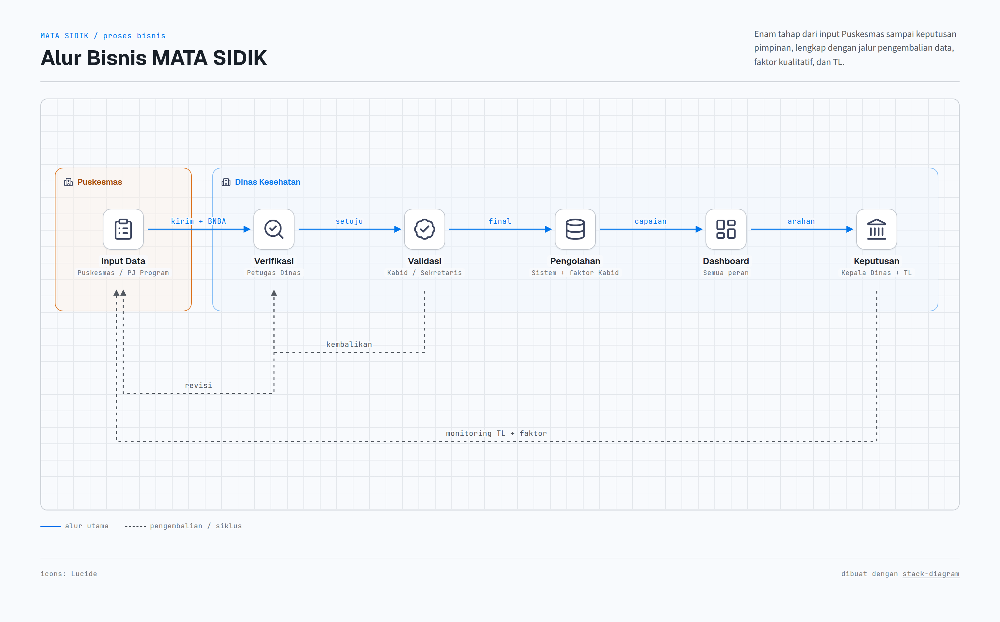
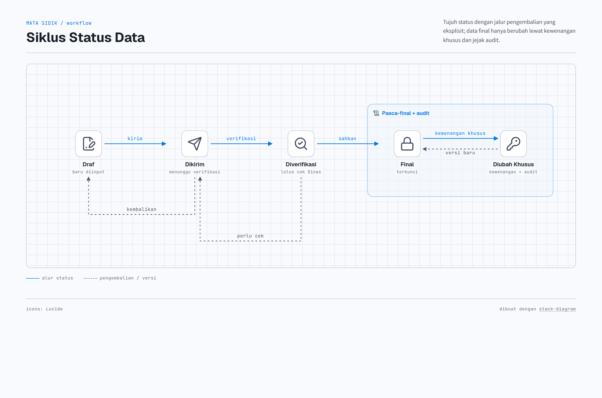
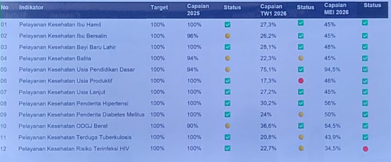
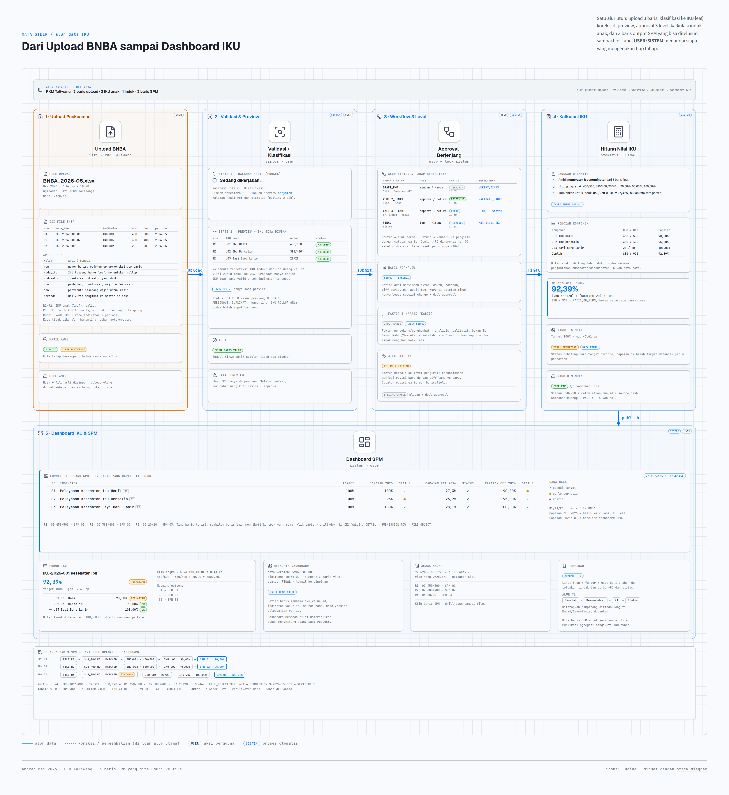
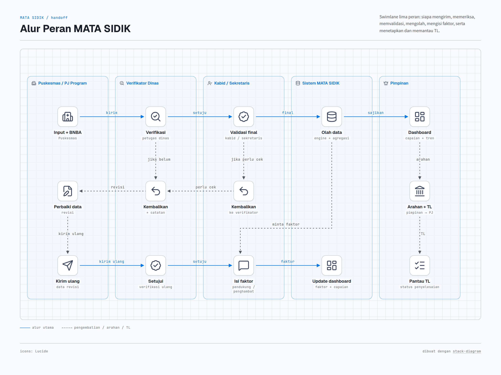
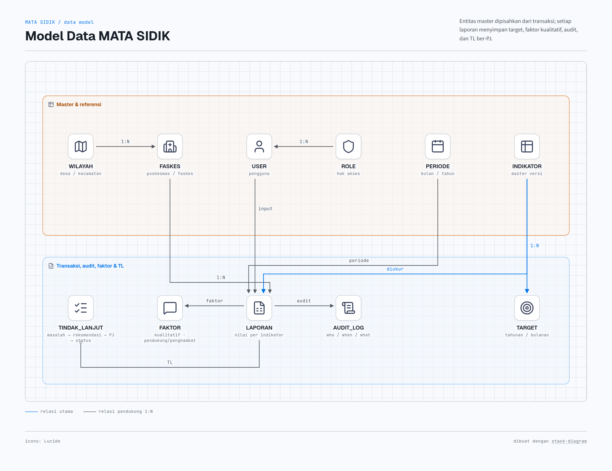
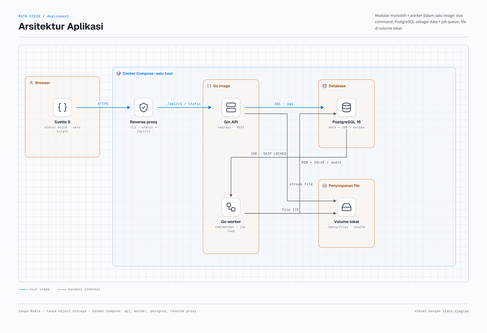
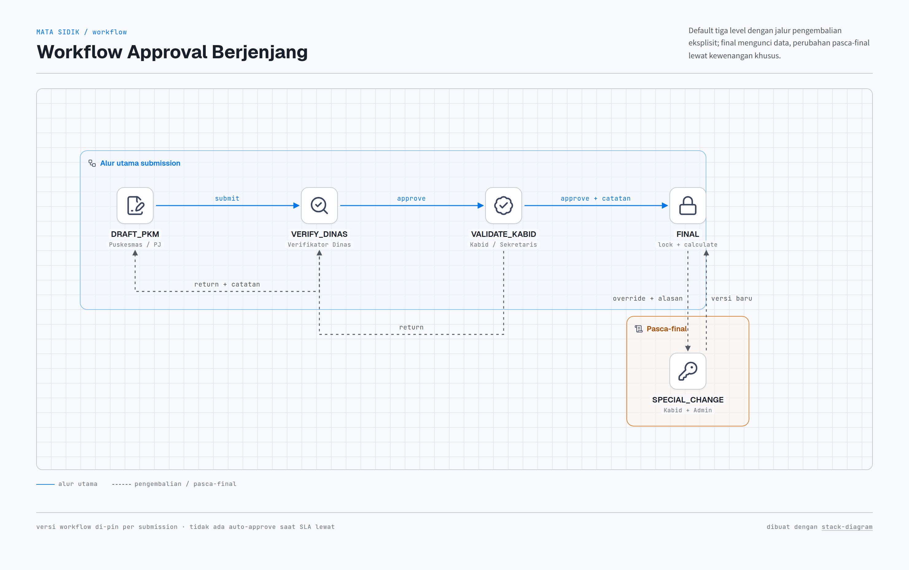

# MATA SIDIK — Manajemen Data dan Sistem Informasi Dinas Kesehatan Kab. Sumbawa Barat

> README gabungan untuk **Dinas (pengguna bisnis)** dan **Developer (pelaksana teknis)**.
> **Wajib dibaca agent:** baca `README.md` ini, lalu [`docs/rules.md`](docs/rules.md), lalu **seluruh file `.md` di [`docs/`](docs/)**, dan [`assets/diagrams/README.md`](assets/diagrams/README.md) bila menyentuh diagram. Jangan mulai mengubah kode atau dokumen sebelum urutan ini selesai.
>
> **Struktur:** `README.md` wajib di root; seluruh dokumen proyek ada di [`docs/`](docs/); `AGENTS.md` berisi instruksi agent.
>
> Disusun dari ekstraksi `Proses Bisnis Mata Sidik.xlsx`:
> - [`docs/01-gambaran-umum.md`](docs/01-gambaran-umum.md) — Sheet Gambaran Umum (A1:F52)
> - [`docs/02-daftar-indikator-kinerja.md`](docs/02-daftar-indikator-kinerja.md) — Sheet Daftar Indikator Kinerja (A1:H62, 58 baris data)
> - [`docs/03-contoh-data.md`](docs/03-contoh-data.md) — Sheet Contoh Data (A1:V39) + `assets/output-dashboard-spm.png`
> - [`docs/04-arsitektur-iku.md`](docs/04-arsitektur-iku.md) — rancangan IKU dinamis, upload terklasifikasi, workflow, dan kalkulasi
> - [`docs/rules.md`](docs/rules.md) — aturan proyek yang mengikat; jangan dilanggar tanpa keputusan eksplisit
>
> Diagram alur, status, peran, model data, dan arsitektur IKU dibuat dengan [stack-diagram](https://github.com/caru-ini/stack-diagram). Sumber HTML + skrip regenerasi ada di [`assets/diagrams/README.md`](assets/diagrams/README.md).

---

## Daftar Isi

- [Peta dokumentasi](#peta-dokumentasi)
- [Bagian A — Untuk Dinas](#bagian-a--untuk-dinas-pengguna-bisnis)
  - [A.7 IKU dinamis: dari upload ke dashboard](#a7-iku-dinamis-dari-upload-ke-dashboard)
- [Bagian B — Untuk Developer](#bagian-b--untuk-developer-pelaksana-teknis)
  - [B.8 Arsitektur IKU dinamis (Go Gin + Svelte)](#b8-arsitektur-iku-dinamis-go-gin--svelte)
  - [B.10 Menjalankan implementasi pilot](#b10-menjalankan-implementasi-pilot)

## Peta dokumentasi

| File | Audiens | Isi |
| --- | --- | --- |
| [`README.md`](README.md) | Dinas, Developer, Agent | Pintu masuk; ringkasan bisnis dan teknis |
| [`AGENTS.md`](AGENTS.md) | Agent | Aturan operasional agent, larangan, protokol kerja, dan ringkasan aturan proyek |
| [`docs/01-gambaran-umum.md`](docs/01-gambaran-umum.md) | Dinas, Developer | Maksud, tujuan, ruang lingkup, alur proses, tabel mentah |
| [`docs/02-daftar-indikator-kinerja.md`](docs/02-daftar-indikator-kinerja.md) | Dinas, Developer | Katalog 58 baris indikator dan label |
| [`docs/03-contoh-data.md`](docs/03-contoh-data.md) | Dinas, Developer | Contoh output dashboard SPM dan data absolut |
| [`docs/04-arsitektur-iku.md`](docs/04-arsitektur-iku.md) | Developer | Rancangan IKU dinamis, upload, workflow, kalkulasi, arsitektur |
| [`docs/schema.md`](docs/schema.md) | Developer | Skema database, relasi, enum, index, seed, dan catatan migrasi SQLite → PostgreSQL |
| [`docs/implementation.md`](docs/implementation.md) | Developer | Struktur proyek, cara run, API pilot, repository pattern, dan batasan implementasi |
| [`docs/rules.md`](docs/rules.md) | Agent, Developer | Aturan proyek yang mengikat dan daftar keputusan terbuka |
| [`assets/diagrams/README.md`](assets/diagrams/README.md) | Developer | Katalog diagram dan cara regenerasi |

**Urutan baca wajib untuk agent:** `README.md` → `docs/rules.md` → `docs/01` → `docs/02` → `docs/03` → `docs/04` → `assets/diagrams/README.md` (bila menyentuh diagram). Baca file secara utuh; jangan mengandalkan ringkasan atau ingatan dari sesi lain.

---

# Bagian A — Untuk Dinas (Pengguna Bisnis)

## A.1 Apa itu MATA SIDIK

Aplikasi untuk mengganti rekap manual menjadi alur terstandar: Puskesmas/bidang input → Dinas memeriksa → Kabid/Sekretaris memvalidasi → sistem mengolah → pimpinan melihat dashboard dan memberi arahan → tindak lanjut dipantau.

Maksud (sumber `docs/01-gambaran-umum.md:15-20`):

| No | Maksud |
| --- | --- |
| 1. | Pengelolaan data kesehatan yang terintegrasi dan terstandar |
| 2. | Kelengkapan, konsistensi, ketepatan waktu, keterlacakan data |
| 3. | Pemantauan indikator per program, faskes, wilayah, periode |
| 4. | Laporan cepat, tanpa rekap manual |
| 5. | Informasi strategis bagi Kepala Dinas/pimpinan |
| 6. | Fondasi analisis, integrasi, dan pemantauan tindak lanjut |

Tujuan (`docs/01-gambaran-umum.md:26-31`): integrasi data Puskesmas/bidang/program, standarisasi format-definisi-periode-sumber, validasi sebelum dipakai, dashboard kinerja, dukung perencanaan–penganggaran–monev, riwayat perubahan + hak akses.

Ruang lingkup (`docs/01-gambaran-umum.md:37-41`):

| No | Kelompok | Isi |
| --- | --- | --- |
| 1. | Pengelolaan Data | Sumber, kamus data, standar indikator, periode, data induk |
| 2. | Pelaporan dan validasi | Kumpul, cek kelengkapan, validasi, kembalikan yang salah, setujui |
| 3. | Pengolahan dan analisis | Rekap, hitung indikator, tren, target vs realisasi, kesenjangan |
| 4. | Penyajian informasi | Dashboard pimpinan, laporan periodik, grafik, peta (bila ada), ekspor |
| 5. | Tindak lanjut dan evaluasi | Masalah, rekomendasi, PJ, pantau penyelesaian |

## A.2 Alur bisnis + peran tiap tahap



*Gambar A.2 — Enam tahap proses bisnis dari input Puskesmas sampai keputusan pimpinan. Garis putus-putus adalah jalur pengembalian serta monitoring faktor dan TL. Diagram dibuat dengan [stack-diagram](https://github.com/caru-ini/stack-diagram); sumber HTML ada di [`assets/diagrams/alur-bisnis.html`](assets/diagrams/alur-bisnis.html).*

### Tabel peran × aksi × data

| Tahap | Pelaku | Aksi | Data masuk | Data keluar / status |
| --- | --- | --- | --- | --- |
| 1. Input | Petugas Puskesmas, PJ program/indikator Dinas | Input angka + upload file BNBA Excel format Puskesmas; kirim per periode | Jumlah layanan, alamat domisili (desa/puskesmas/kecamatan), periode | Status: Draf → Dikirim |
| 2. Verifikasi | Petugas Dinas (kabupaten) | Cek kelengkapan; setujui atau kembalikan dengan catatan | Data terkirim | Status: Diverifikasi / Dikembalikan ke tahap 1 |
| 3. Validasi | Kepala Bidang / Sekretaris Dinas | Setujui final atau kembalikan ke tahap 2; perubahan data final butuh kewenangan khusus + jejak audit | Data terverifikasi | Status: Final (terkunci) / Dikembalikan ke tahap 2 |
| 4. Pengolahan | Sistem (otomatis) + Kabid/Sekretaris | Rekap, hitung indikator, tren, kesenjangan; Kabid/Sekretaris wajib isi faktor pendukung + penghambat (analisis kualitatif; bukan TL) | Data final + target | Tren capaian, gap target–realisasi, faktor |
| 5. Dashboard | Semua (sesuai hak akses) | Lihat/filter/ekspor per 9 pengelompokan (lihat A.4) | Data olahan | Grafik, tabel, laporan periodik |
| 6. Keputusan | Kepala Dinas/pimpinan → Kabid/Sekretaris | Beri arahan, tetapkan TL (masalah → rekomendasi → PJ → status), pantau evaluasi | Capaian + faktor + gap | Arahan, TL ber-PJ dan berstatus |

**Faktor vs TL:** faktor adalah analisis kualitatif (pendukung/penghambat) dan tidak mengubah angka; TL adalah rencana aksi ber-PJ dan berstatus (masalah → rekomendasi → PJ → status).

Siklus status data — lima status inti dengan dua jalur pengembalian eksplisit:



*Gambar A.2b — Dua status pengembalian (`dikembalikan_petugas`, `dikembalikan_verifikator`) ditampilkan sebagai jalur panah agar alur utama tetap ringkas; enum lengkap ada di [B.5](#b5-skema-master-indikator-dinamis--raci-per-label). Sumber HTML: [`assets/diagrams/status-data.html`](assets/diagrams/status-data.html).*

Jejak audit wajib catat (sumber `docs/01-gambaran-umum.md:61`): **siapa** mengirim / memeriksa / menyetujui / mengubah + **kapan** (waktu tindakan). Filter status menurut faskes, bidang, program, indikator, periode.

## A.3 Contoh nyata (SPM)

Contoh `docs/03-contoh-data.md:19-30` — target 100%, capaian 2025, TW1 2026, Mei 2026 untuk 12 indikator (Ibu Hamil s.d. Risiko HIV). Detail angka absolut (`docs/03-contoh-data.md:40`): Target 2026 = 2000, Target Bulanan = 166,67 (`2000/12`), Januari = 155, Februari = 120.



Input Puskesmas (`docs/03-contoh-data.md:61`): yang diinput adalah data ibu hamil dilayani sesuai standar + file BNBA; sistem diharapkan memetakan sebaran per desa/puskesmas/kecamatan dan menandai wilayah yang banyak tidak terlayani standar.

## A.4 Pengelompokan laporan (9 kategori)

`docs/01-gambaran-umum.md:77-85`: IKU (Tujuan/Sasaran), IKK, SPM, RIBK, Program, Kegiatan, Sub Kegiatan, Bidang/Sekretariat/Tim Kerja, + 1 baris `........................` (belum defined — perlu keputusan Dinas).

Katalog indikator lengkap (58 baris, No.1–12 + tanpa nomor + `dst belum selesai`): lihat `docs/02-daftar-indikator-kinerja.md:17-74`. Contoh terisi: UHH, Kematian Ibu/Balita, Stunting — dengan label ganda (IKU; Sasaran; IKK; RIBK; Kesmas).

## A.5 Yang perlu dilengkapi Dinas (daftar keputusan)

1. **Definisi Operasional** masih kosong semua (`docs/02-daftar-indikator-kinerja.md:15`) — tiap indikator butuh numerator/denominator, sumber, frekuensi.
2. **Satuan** belum baku (`%` vs `Persentase` vs `(%)`, `Poin`, `Kasus`, `Dokumen`, `Rasio`) — pilih satu kosakata.
3. **Duplikasi**: 3 baris identik ibu hamil (`docs/02-daftar-indikator-kinerja.md:29-31`) — gabung atau bedakan (TW1/Mei/absolut?).
4. **PJ Data** baru terisi 5 baris awal — tetapkan Bidang + Timker/Subbag untuk semua.
5. **Kategori ke-9** (`........................`) — definisikan atau hapus.
6. **Aturan Status** ✅🟡🔴 pada dashboard — tetapkan ambang batas (mis. ≥90% hijau).
7. **SLA**: berapa hari batas input/verifikasi/validasi per periode; siapa diingatkan bila terlambat.
8. **Format BNBA**: kunci kolom Excel Puskesmas agar upload tidak gagal.

## A.6 Catatan: file `02` adalah master dinamis (bukan laporan mati)

`docs/02-daftar-indikator-kinerja.md:15-74` berisi 58 baris + baris `dst belum selesai` — artinya katalog masih tumbuh. Fungsinya sebagai **kamus yang mengendalikan aplikasi**: nama/satuan menentukan tampilan form, definisi menentukan rumus engine, label menentukan kelompok dashboard, sifat data menentukan siapa input dan seberapa sering, PJ menentukan routing ke bidang mana.

Konsekuensi praktis bagi Dinas: tiap tambah indikator baru wajib melengkapi 6 field (satuan baku, definisi + pembilang/penyebut, label, sifat input, frekuensi, PJ Bidang/Timker). Tanpa itu indikator tidak bisa dihitung atau dimunculkan di dashboard. Lihat detail teknis skema berversi di [B.5](#b5-skema-master-indikator-dinamis--raci-per-label).

## A.7 IKU dinamis: dari upload ke dashboard

Katalog indikator tidak lagi diperlakukan sebagai daftar datar. IKU menjadi **label many-to-many** yang dapat memiliki anak dinamis, dan nilai IKU induk dihitung dari komponen yang eksplisit — bukan sekadar merata-ratakan persentase anak.



*Gambar A.7 — Satu alur utuh: upload 3 baris, koreksi IKU di preview, approval Puskesmas → Dinas → Kabid, kalkulasi induk–anak, dan dashboard. Sumber HTML: [`assets/diagrams/alur-data-iku.html`](assets/diagrams/alur-data-iku.html). Rancangan lengkap: [`docs/04-arsitektur-iku.md`](docs/04-arsitektur-iku.md).*

Tahap 5 ditempatkan di bagian bawah sebagai **dashboard final**, bukan di deretan proses. Panel ini menampilkan **3 baris acuan output dashboard SPM** (target, capaian 2025/TW1/Mei 2026, dan status capaian) beserta Pohon IKU, metadata, jejak angka, dan panel pimpinan. Panel pimpinan memuat arahan dan alur TL: masalah → rekomendasi → PJ → status. Setiap baris punya penanda `R1`/`R2`/`R3` yang bisa ditelusuri balik ke baris upload, `INDICATOR_VALUE`, `IKU_VALUE` leaf, lalu `FILE_OBJECT`.

### Cara membaca alurnya

| Tahap | Yang terjadi | Yang dilihat pengguna |
| --- | --- | --- |
| 1. Upload | Puskesmas mengunggah BNBA; file wajib memuat `kode_iku`, `kode_indikator`, dan periode | Form upload + konfirmasi file |
| 2. Validasi & klasifikasi | Sistem memproses di background: cek header, kode, scope, nilai, lalu mencocokkan baris ke IKU | Halaman **“Sedang dikerjakan…”** dengan progres; tidak menunggu di request upload |
| 3. Preview | Baris yang cocok ditampilkan; baris ambigu/mismatch dikarantina; IKU dapat dipilih ulang lewat dropdown | Tabel per baris + status + tombol **Ubah IKU** |
| 4. Workflow | Setelah dikirim, data masuk approval berjenjang; setiap level bisa menerima/menolak dengan catatan | Timeline, catatan revisi, diff lama vs baru |
| 5. Kalkulasi & dashboard (tahap 4–5) | Data final dihitung: nilai anak, lalu induk memakai `RATIO_OF_SUMS`; dashboard ditempatkan di bawah alur sebagai output final | Nilai IKU, target, gap, status, jejak angka, dan 3 baris SPM yang terhubung ke file |

### Contoh angka pada diagram

| Komponen | Perhitungan | Hasil |
| --- | --- | --- |
| `IKU-2026-001.01` — Ibu Hamil | `450 / 500` | **90,00%** |
| `IKU-2026-001.02` — Ibu Bersalin | `380 / 400` | **95,00%** |
| `IKU-2026-001.03` — Bayi Baru Lahir | `20 / 20` | **100,00%** |
| `IKU-2026-001` — induk | `(450 + 380 + 20) / (500 + 400 + 20) = 850 / 920` | **92,39%** |
| Target | 100% | gap **-7,61 pp** |

Baris R3 pada contoh semula memakai kode IKU induk (rollup-only). Di preview, baris itu diubah ke `.03`, sehingga nilai 20/20 masuk ke `.03` dan baris SPM 03 tampil. Tanpa koreksi, `.03` tidak punya data (`NO_DATA`) dan induk 830/900 = 92,22%. Perbedaan ini menunjukkan mengapa **preview, pemilihan IKU, dan klasifikasi** harus eksplisit.

### Yang berubah bagi Dinas

1. **Satu indikator, banyak label.** Indikator yang sama bisa muncul di IKU, Indikator Sasaran, IKK, RIBK, dan SPM tanpa menduplikasi nilai.
2. **IKU punya kode dan hierarki.** Kode IKU/anak IKU menjadi penanda upload; nama dan formula boleh berubah lewat versi.
3. **IKU induk tidak menerima upload langsung.** Nilainya dihitung dari IKU anak/indikator komponen yang eksplisit.
4. **Klasifikasi tidak menebak.** Kode tidak dikenal atau ambigu masuk karantina; sistem tidak membuat master baru dari file.
5. **Approval menyesuaikan pemilik data.** Submission lintas bidang dipecah per pemilik, sehingga tidak saling menunggu.
6. **Final terkunci dan dapat diaudit.** Koreksi pasca-final lewat mekanisme khusus dengan alasan dan persetujuan ganda.

> Detail teknis (skema, job background, auth, kalkulasi, gap/edge case, roadmap) ada di [`docs/04-arsitektur-iku.md`](docs/04-arsitektur-iku.md).

---

# Bagian B — Untuk Developer (Pelaksana Teknis)

## B.1 Modul yang disarankan (dipetakan dari ruang lingkup)

| Modul | Fungsi | Sumber |
| --- | --- | --- |
| Master | Wilayah (desa/kec/puskesmas), Faskes, Bidang/Timker, Indikator + Label, Periode, Target | 01 §4.1, 02 katalog, 03 BNBA |
| Ingest | Input manual + upload BNBA Excel (template Puskesmas), validasi format | 01 §5.1, 03 §3 |
| Workflow | Kirim → verifikasi → validasi → final → pengembalian + notifikasi | 01 §5.2–5.3 |
| Engine | Rekap, `target_bulanan = target_tahunan/12`, capaian %, tren, gap | 03 §2 |
| Faktor & TL | Form faktor pendukung/penghambat (wajib saat olahan terbit); CRUD tindak lanjut (masalah→rekomendasi→PJ→status) | 01 §5.4, §5.6 |
| Dashboard | 9 pengelompokan + filter (faskes/bidang/program/indikator/periode/wilayah) + ekspor | 01 §5.5 |
| Audit & RBAC | Log who/when/what + penguncian data final | 01 §5.3 note |

## B.2 Alur peran (swimlane)



*Gambar B.2 — Handoff antarperan. Alur utama: input + BNBA → verifikasi → validasi final → olah data → dashboard → arahan pimpinan. Garis putus-putus menunjukkan pengembalian data, permintaan isi faktor, serta arahan dan TL. Faktor diisi Kabid/Sekretaris; TL ditetapkan pimpinan, ditindaklanjuti Kabid/Sekretaris, dan dipantau. Sumber HTML: [`assets/diagrams/alur-peran.html`](assets/diagrams/alur-peran.html).*

## B.3 Model data (usulan awal)



*Gambar B.3 — Pemisahan master/referensi dari transaksi, faktor, audit, dan TL. Sumber HTML: [`assets/diagrams/model-data.html`](assets/diagrams/model-data.html).*

Skema database lengkap (30 tabel, kolom, relasi, index, enum, seed, dan catatan migrasi) ada di [`docs/schema.md`](docs/schema.md); diagram katalognya ada di [`assets/diagrams/schema-db.png`](assets/diagrams/schema-db.png).

### Field kunci per entitas

| Entitas | Field kunci | Peran |
| --- | --- | --- |
| `WILAYAH` | `id`, `nama`, `level` (desa/kecamatan) | hierarki pelaporan |
| `FASKES` | `id`, `nama`, `wilayah_id` FK | sumber data Puskesmas |
| `USER` / `ROLE` | `id`, `nama`, `role_id` FK, `faskes_id` FK, `bidang_id` FK / `id`, `nama` | akun + RBAC |
| `PERIODE` | `id`, `tahun`, `bulan` | batas periode pelaporan |
| `INDIKATOR` / `INDIKATOR_VERSI` | `id`, `nama`, `status_aktif` / `indikator_id` FK, `satuan_baku`, `definisi`, `numerator`, `denominator`, `sifat_input`, `frekuensi`, `pj_bidang_id` FK, `pj_timker_id` FK, `berlaku_dari`, `berlaku_sampai` | master dinamis (lihat B.5) |
| `LABEL` / `LABEL_VERSION` / `INDIKATOR_LABEL` | `id`, `kode`, `tipe`, `parent_id`, `nama`, `master_release_id` / `indikator_version_id` FK, `label_version_id` FK, `bobot` | taksonomi many-to-many + hierarki IKU |
| `TARGET` | `id`, `indikator_versi_id` FK, `periode_id` FK, `target_tahunan`, `target_bulanan` | target tahunan/bulanan |
| `LAPORAN` | `id`, `indikator_versi_id` FK, `periode_id` FK, `faskes_id` FK, `user_id` FK, `nilai`, `status` | transaksi utama |
| `FAKTOR` | `id`, `laporan_id` FK, `pendukung`, `penghambat` | analisis kualitatif |
| `AUDIT_LOG` | `id`, `laporan_id` FK, `user_id` FK, `aksi`, `waktu`, `catatan` | jejak audit |
| `TINDAK_LANJUT` | `id`, `laporan_id` FK, `masalah`, `rekomendasi`, `pj_user_id` FK, `status` | tindak lanjut ber-PJ |

## B.4 Matriks hak akses (RBAC awal — selaraskan dengan Dinas)

| Aksi | Puskesmas/PJ | Verifikator Dinas | Kabid/Sekretaris | Pimpinan | Admin |
| --- | --- | --- | --- | --- | --- |
| Input/kirim + upload BNBA | ✅ | ❌ | ❌ | ❌ | ✅ (bantuan) |
| Verifikasi/kembalikan ke pengirim | ❌ | ✅ | ❌ | ❌ | ❌ |
| Validasi final/kembalikan ke verifikator | ❌ | ❌ | ✅ | ❌ | ❌ |
| Ubah data final (khusus + audit) | ❌ | ❌ | ✅ terbatas | ❌ | ✅ dual approval |
| Isi faktor pendukung/penghambat | ❌ | ❌ | ✅ wajib | ❌ | ❌ |
| Lihat dashboard semua filter | milik sendiri | bidangnya | bidangnya | ✅ semua | ✅ |
| Beri arahan / tetapkan TL | ❌ | ❌ | terima | ✅ beri | ❌ |
| Kelola master + user | ❌ | ❌ | ❌ | ❌ | ✅ |

## B.5 Skema master indikator dinamis + RACI per label

File `02` adalah master hidup (ada baris `dst belum selesai`). Aturan: tambah = versi baru, nonaktifkan = set `berlaku_sampai` + `status_aktif=false`. Jangan hapus fisik agar tren historis utuh. Setiap versi wajib isi: satuan baku, definisi + numerator/denominator, label (many-to-many via `INDIKATOR_LABEL`), sifat input, frekuensi, level wilayah, PJ bidang/timker.

Contoh sifat dari sumber: UHH = input langsung kabupaten 1x/tahun (`docs/02-daftar-indikator-kinerja.md:17`); Kematian Ibu/Balita = input Puskesmas lalu agregat Desa/Puskesmas/Kecamatan/Kabupaten (`docs/02-daftar-indikator-kinerja.md:18-19`).

### RACI per label dashboard (R=pelaksana, A=penanggung jawab, C=konsultan, I=informed)

| Label | Input (Puskesmas/PJ) | Verifikasi (Petugas Dinas) | Validasi (Kabid/Sekretaris) | Pimpinan |
| --- | --- | --- | --- | --- |
| IKU / Sasaran / IKK / RIBK | R | R | A | I |
| SPM (12 contoh di `03`) | R | R | A | I |
| Program / Kegiatan / Sub Kegiatan | R (PJ program) | R | A (Kabid pemilik) | I |
| Bidang / Sekretariat / Timker | R | C | A | I |
| Arahan + TL | I | C | R (eksekusi) | A (pemberi arahan) |

### Enum status formal (7 nilai: 5 status inti + 2 status pengembalian)

| Status | Arti | Boleh dilakukan oleh |
| --- | --- | --- |
| `draf` | Baru diinput, belum dikirim | Puskesmas/PJ |
| `dikirim` | Menunggu verifikasi | Sistem (terkunci untuk pengirim) |
| `diverifikasi` | Lolos cek Dinas, menunggu validasi | Verifikator |
| `dikembalikan_petugas` | Belum sesuai, kembali ke tahap 1 + catatan | Verifikator |
| `dikembalikan_verifikator` | Perlu cek, kembali ke tahap 2 | Kabid/Sekretaris |
| `final` | Sah, terkunci, masuk engine + dashboard | Kabid/Sekretaris |
| `diubah_khusus` | Perubahan pasca-final via kewenangan khusus, wajib audit | Kabid/Sekretaris + Admin |

Setiap transisi tulis `AUDIT_LOG` (who/when/what + catatan).

## B.6 Aturan teknis kunci

- `target_bulanan = target_tahunan / 12` (contoh 2000 → 166,67). Target bulanan persentase = 8,33%.
- `capaian_% = realisasi / target × 100` per periode; simpan pembilang–penyebut, bukan hanya %.
- Status workflow lihat enum formal di B.5; setiap transisi tulis `AUDIT_LOG`.
- Upload BNBA: validasi header template Puskesmas, tolak baris tanpa domisili (desa/puskesmas/kecamatan), simpan file asli + hasil parsing untuk audit.
- Upload dinamis: wajib `kode_iku` + `kode_indikator` + periode; klasifikasi deterministik; baris ambigu/mismatch masuk karantina; IKU induk tidak menerima input langsung.
- Agregasi wilayah: Desa → Puskesmas → Kecamatan → Kabupaten (kasus kematian ibu/balita wajib bisa di-drill-down; UHH hanya level kabupaten, input 1×/tahun).
- Agregasi IKU induk: `RATIO_OF_SUMS` dari komponen eksplisit (`IKU_KOMPONEN`), bukan rata-rata persentase; simpan provenance di `IKU_VALUE_DETAIL`.
- Dashboard: 9 kategori §A.4 sebagai facet; setiap kartu tampilkan Target, Capaian, Status, Tren; Status dasar dihitung dari target periode; ambang warna formal menunggu keputusan A.5 no.6.
- Ekspor: laporan periodik (PDF/Excel) + grafik; peta sebaran opsional tahap 2.

## B.7 Backlog dari gap analisis (prioritas)

1. P1 — Normalisasi satuan + dedup indikator + lengkapi definisi/formula (blokir engine).
2. P1 — Template BNBA resmi + parser background + klasifikasi IKU + preview ubah IKU + pesan error baris.
3. P1 — Workflow engine + lock data final + audit log.
4. P2 — Form faktor pendukung/penghambat wajib + CRUD tindak lanjut ber-PJ.
5. P2 — Dashboard 8 kategori pasti + ke-9 menunggu Dinas; filter 5 dimensi + agregasi wilayah.
6. P3 — Notifikasi SLA, ekspor, peta, integrasi SIKN (baris `docs/02-daftar-indikator-kinerja.md:50` menyebut integrasi SIKN).

## B.8 Arsitektur IKU dinamis (Go Gin + Svelte)

Rancangan lengkap ada di [`docs/04-arsitektur-iku.md`](docs/04-arsitektur-iku.md); ringkasan teknisnya:

**Bentuk:** modular monolith + worker, satu image dengan dua command (`api`, `worker`). Tidak ada Redis dan tidak ada object storage.



*Gambar B.8 — Satu host Docker Compose: `api` dan `worker` memakai image yang sama, PostgreSQL menyimpan data + job queue + outbox, dan file asli berada di volume lokal. Sumber HTML: [`assets/diagrams/arsitektur-aplikasi.html`](assets/diagrams/arsitektur-aplikasi.html); rancangan lengkap di [`docs/04-arsitektur-iku.md` §6](docs/04-arsitektur-iku.md#6-arsitektur-aplikasi).*

| Keputusan | Implementasi |
| --- | --- |
| Upload background | `POST /submissions` menyimpan file + `JOB`, balas `202 {submission_id, job_id}`; UI polling `GET /jobs/{id}` |
| Tanpa Redis | Job queue di tabel `JOB` dengan `FOR UPDATE SKIP LOCKED`, heartbeat, retry, `dead` + alert |
| Tanpa object storage | File di volume lokal dengan nama `sha256`; metadata di `FILE_OBJECT`; backup volume wajib |
| Go + Gin | `gin-gonic/gin` untuk router/middleware, `pgx`/`sqlc`, `goose`; parser Excel, engine kalkulasi, workflow dalam satu modul |
| Svelte | Svelte 5 + Vite; build statis satu origin dengan API; halaman loading + preview + timeline |
| Auth | PASETO v4.local akses 30 menit + refresh rotasi (hash di DB), RBAC/scope, MFA TOTP untuk approver |
| Observability | Log JSON ke stdout, rotasi log container, `/metrics`, `/healthz`, `/readyz`; tanpa APM |
| Deployment | Docker Compose: `api`, `worker`, `postgres`, reverse proxy, volume `pgdata` + `files` |

**HTTP layer Gin:** `gin.New()` dengan middleware eksplisit (request ID, log JSON, recovery, metrics), route group `/api/v1`, binding DTO + validator, dan helper `respondError` untuk format error konsisten. SPA disajikan lewat `NoRoute` (fallback `index.html`); file hanya lewat `/api/v1/files/{id}`. Worker tidak memakai Gin. Detail: [`docs/04-arsitektur-iku.md` §6.2.1](docs/04-arsitektur-iku.md#621-kerangka-http-gin).

**Alur klasifikasi:** `kode_iku` + `kode_indikator` + `periode` → cocokkan `INDIKATOR_LABEL` → cek `allow_direct_input` → status `MATCHED`/`MISMATCH`/`IKU_ROLLUP_ONLY`/`AMBIGUOUS`/`DUPLICATE`. Hanya IKU leaf yang boleh menerima upload; IKU induk dihitung dari `IKU_KOMPONEN`.

**Preview:** dropdown “Ubah IKU” hanya berisi IKU leaf valid untuk indikator tersebut. Perubahan sebelum submit dicatat di audit; setelah submit, perubahan mengikuti revisi + approval.

**Workflow:** default `DRAFT_PKM → VERIFY_DINAS → VALIDATE_KABID → FINAL`, dengan `SUBMISSION_GROUP` per pemilik data untuk submission lintas bidang. Versi workflow di-pin per submission. Catatan wajib saat return dan final; tidak ada auto-approve.



*Gambar B.8b — State machine approval lengkap: tiga level approval, jalur return, dan `SPECIAL_CHANGE` pasca-final. Sumber HTML: [`assets/diagrams/alur-workflow.html`](assets/diagrams/alur-workflow.html); generator: [`assets/diagrams/gen-teknis.py`](assets/diagrams/gen-teknis.py).*

**Kalkulasi:** `RATIO_OF_SUMS` untuk persentase (`Σ numerator / Σ denominator`), komponen induk eksplisit, provenance di `IKU_VALUE_DETAIL`, status `COMPLETE/PARTIAL/NO_DATA/STALE`. Contoh: `.01` 450/500 = 90,00%; `.02` 380/400 = 95,00%; `.03` 20/20 = 100,00%; induk 850/920 = 92,39%.

**Trace output SPM:** setiap baris SPM membawa `iku_value_id`, `indicator_value_id`, `source_hash`, dan `data_version`; drill-down berjalan `SPM → IKU_VALUE → IKU_VALUE_DETAIL → INDICATOR_VALUE → SUBMISSION_ROW → SUBMISSION_REVISION → FILE_OBJECT`. Detail di [`docs/04-arsitektur-iku.md` §5.5](docs/04-arsitektur-iku.md#55-tracing-output-dashboard-spm).

Gap/edge case P0–P2, acceptance criteria, dan roadmap ada di [`docs/04-arsitektur-iku.md` §8–§9](docs/04-arsitektur-iku.md#8-gap-dan-edge-case).

## B.9 Referensi silang

- Bisnis mentah: `docs/01-gambaran-umum.md:100-151` (tabel mentah 50 baris).
- Katalog: `docs/02-daftar-indikator-kinerja.md:15-74` (jangan hapus kolom kosong — itu penanda PR).
- Contoh hitung + gambar: `docs/03-contoh-data.md:17-51`, `assets/output-dashboard-spm.png`.
- Aturan proyek (mengikat): `docs/rules.md`.
- Diagram (sumber HTML, PNG, cara regenerasi): `assets/diagrams/README.md`.
- Skema database: [`docs/schema.md`](docs/schema.md).
- Struktur & cara run implementasi: [`docs/implementation.md`](docs/implementation.md).

## B.10 Menjalankan implementasi pilot

Implementasi pilot memakai **Go Gin + SQLite + PASETO v4.local** dan **SvelteKit + shadcn-svelte/neobrutalism**. Login memakai username/password, refresh token HttpOnly, RBAC, dan actingAs admin. Database + data awal dibuat otomatis saat API pertama kali berjalan.

```bash
# terminal 1 — backend + worker inline
cd backend
go run ./cmd/api

# terminal 2 — frontend
cd frontend
npm install
npm run dev
```

- API: `http://localhost:8080` · frontend dev: `http://localhost:5173` (proxy `/api`).
- Login awal: `admin`, `siti`, `rina`, `kabid`, `pimpinan`, `sekretaris`, `pjgizi` — password `password123` (ganti sebelum produksi).
- Set `APP_AUTH_KEY` (64 hex chars = 32 byte) agar access token tetap valid setelah restart; jika kosong API memakai kunci acak sementara (refresh token di DB tetap bekerja).
- Access token PASETO v4.local 30 menit; refresh token HttpOnly 7 hari; admin dapat memakai **ActingAs**.
- Halaman login menampilkan fungsi aplikasi di kiri dan form di kanan; alur empat langkah ditampilkan sebagai satu baris ringkas tanpa label jabatan: upload → verifikasi → validasi → final.
- Semua user dapat membuka **Profil** untuk mengubah nama tampilan dan password sendiri; peran, jabatan, dan faskes tetap diatur admin.
- Admin mengisi **Capaian tahunan** di halaman Master. Dashboard periode 2026 otomatis memakai capaian 2025; ganti periode ke 2027 berarti memakai capaian 2026 tanpa menimpa histori.
- Build frontend: `npm run build`; Go menyajikan `frontend/build` pada `APP_WEB_DIR`.
- Test: `cd backend && go test ./...` · `cd frontend && npm run check`.
- Data awal: submission final `S-2026-05-001`, 3 baris, induk 92,39%.
- Reset data: hapus `backend/data/` lalu jalankan API lagi.

Rincian struktur, endpoint, repository pattern, dan batasan ada di [`docs/implementation.md`](docs/implementation.md); skema database di [`docs/schema.md`](docs/schema.md).
