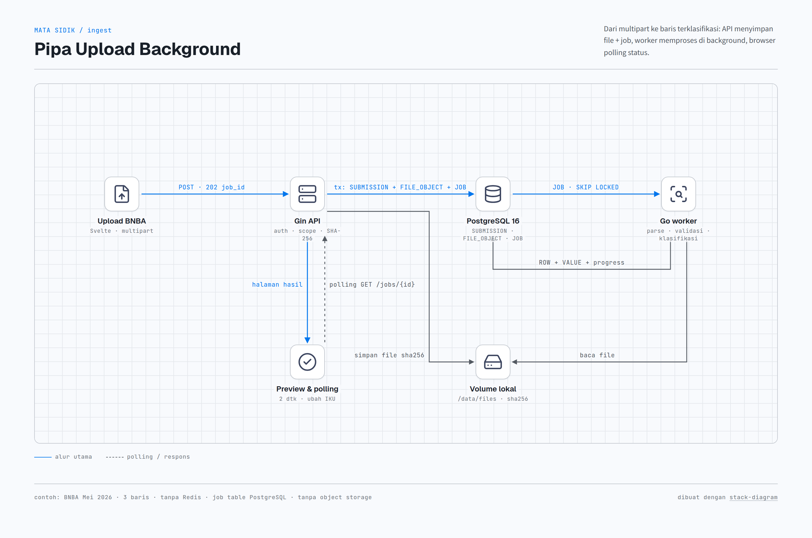
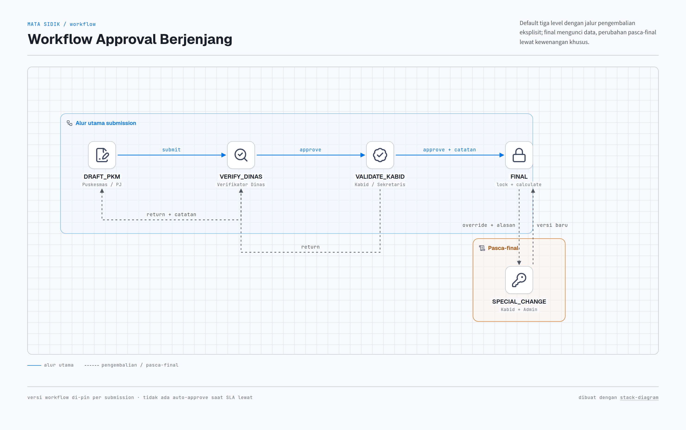
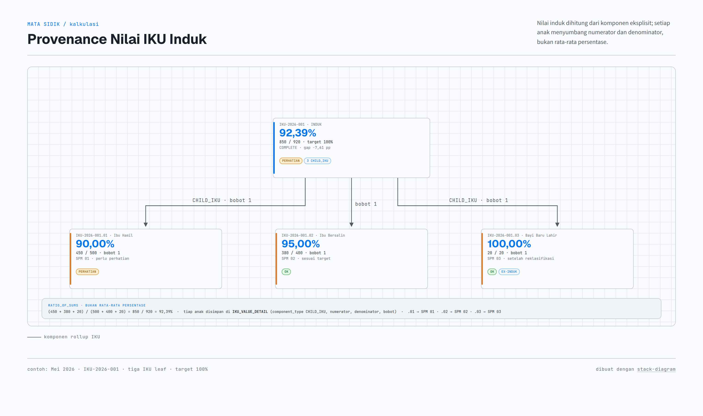
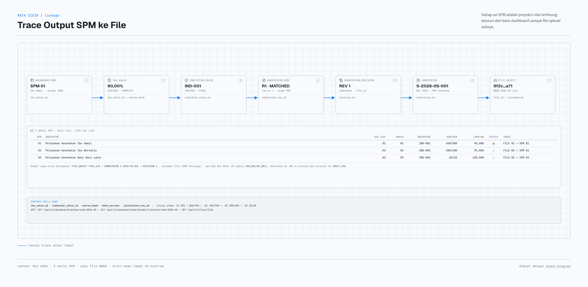
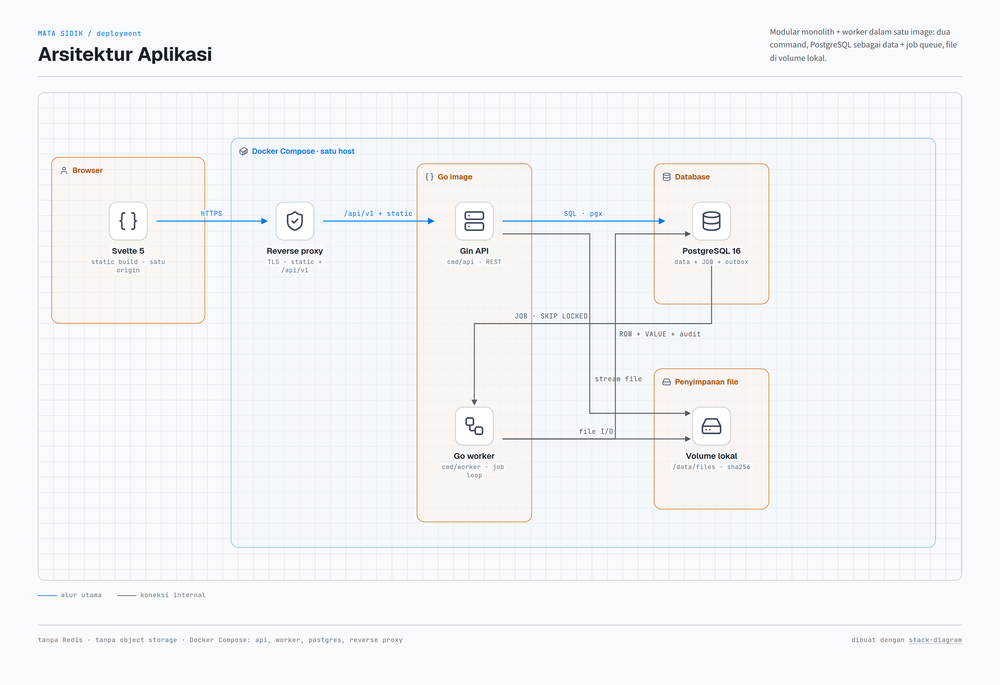
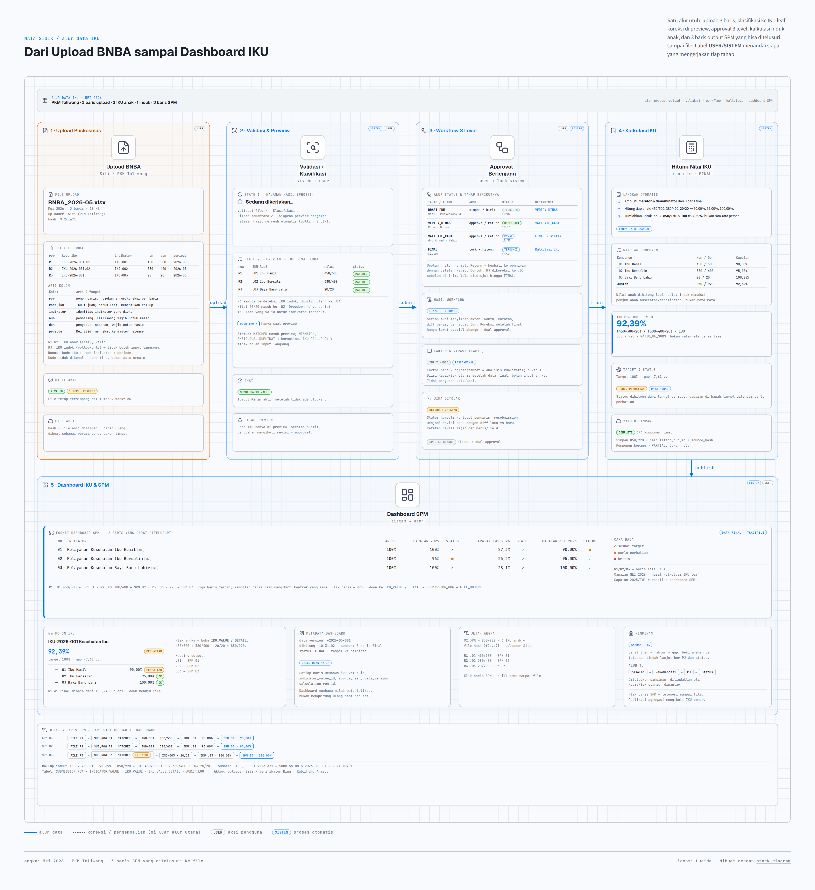

# Arsitektur IKU Dinamis — MATA SIDIK

> Dokumen rancangan teknis untuk **IKU dinamis, upload terklasifikasi, workflow berjenjang, dan kalkulasi induk–anak**.
> Terkait: [`README.md`](../README.md) bagian A.7 dan B.8, [`01-gambaran-umum.md`](01-gambaran-umum.md), [`02-daftar-indikator-kinerja.md`](02-daftar-indikator-kinerja.md), [`03-contoh-data.md`](03-contoh-data.md).
> Aturan proyek yang mengikat: [`rules.md`](rules.md).
> Skema database implementasi: [`schema.md`](schema.md).
> Diagram end-to-end: [`../assets/diagrams/alur-data-iku.png`](../assets/diagrams/alur-data-iku.png).

---

## 0. Ringkasan keputusan

| No | Keputusan | Alasan |
| --- | --- | --- |
| 1 | IKU adalah **label many-to-many**, bukan kolom tunggal di indikator | Satu indikator bisa sekaligus IKU, Indikator Sasaran, IKK, RIBK, dan SPM |
| 2 | Taksonomi label dipisahkan dari **graf kalkulasi** | Label menentukan tampilan; `IKU_KOMPONEN` menentukan angka induk |
| 3 | Upload memakai **tiga kunci**: `kode_iku`, `kode_indikator`, `periode` | Kode IKU saja tidak cukup untuk menentukan baris data |
| 4 | Klasifikasi **deterministik**; ragu masuk karantina | Tidak boleh ada data yang masuk IKU secara diam-diam |
| 5 | Hanya **IKU leaf/direct-input** yang boleh menerima upload | IKU induk murni rollup, nilainya dihitung sistem |
| 6 | IKU induk memakai **komponen eksplisit** + `RATIO_OF_SUMS` | Mencegah double counting dan rata-rata persentase yang menyesatkan |
| 7 | Workflow bertingkat **dinamis tetapi berversi** | Perubahan alur tidak boleh mengubah pengajuan yang sedang berjalan |
| 8 | Setiap keputusan menyimpan **aktor, waktu, catatan, diff, versi** | Audit dan pertanggungjawaban |
| 9 | Arsitektur: **modular monolith + worker**, PostgreSQL, volume lokal | Skala satu Dinas; tanpa Redis dan tanpa object storage |
| 10 | Backend **Go + Gin**, frontend **Svelte**, auth produksi tanpa Keycloak | Deployment sederhana, satu bahasa backend, satu origin |

---

## 1. Prinsip dan batasan

### 1.1 Prinsip

1. **Satu nilai dasar, banyak label.** Nilai indikator disimpan sekali; label hanya menghubungkan ke dashboard/kelompok.
2. **Kode adalah kontrak.** `kode_iku` dan `kode_indikator` stabil; nama boleh berubah lewat versi.
3. **Tidak ada auto-create master dari file upload.** Master hanya berubah lewat alur publikasi master data.
4. **Angka harus bisa ditelusuri.** Setiap nilai IKU dapat dirunut ke komponen, baris upload, file, dan pengunggah.
5. **Final berarti terkunci.** Perubahan setelah final hanya lewat mekanisme khusus dengan alasan dan persetujuan ganda.
6. **Gagal dengan jelas, bukan menebak.** Baris ambigu dikarantina dan ditampilkan ke pengguna.

### 1.2 Batasan implementasi

| Batasan | Konsekuensi desain |
| --- | --- |
| Tanpa Redis | Job queue, lock, dan notifikasi memakai tabel PostgreSQL + `FOR UPDATE SKIP LOCKED` |
| Tanpa object storage | File disimpan di volume lokal dengan metadata di database; backup volume wajib |
| Upload diproses di background | API mengembalikan `202 + job_id`; UI menampilkan halaman proses dan polling status |
| Backend Go + Gin | HTTP API memakai Gin; worker, parser, kalkulasi, dan auth dalam satu binary/modul Go |
| Frontend Svelte | SPA Svelte 5 + Vite; build statis disajikan satu origin dengan API |
| Auth tanpa Keycloak | PASETO v4.local akses singkat + refresh token rotasi + RBAC/scope + MFA untuk approver |
| Observability level container | Log JSON ke stdout, metrik Prometheus, health check, rotasi log container; tanpa APM/tracing terdistribusi |
| Skala awal satu Dinas | Modular monolith, bukan microservices; satu image dengan dua entrypoint (`api`, `worker`) |

---

## 2. Model domain

### 2.1 Tiga konsep yang harus dipisahkan

| Konsep | Fungsi | Contoh |
| --- | --- | --- |
| **Label** | Taksonomi dan tampilan dashboard | `IKU`, `Indikator Sasaran`, `IKK`, `SPM`, `RIBK`, `Program` |
| **IKU node** | Label bertipe IKU yang punya hierarki, formula, target, dan pemilik | `IKU-2026-001 Kesehatan Ibu` → `IKU-2026-001.01 Ibu Hamil` |
| **Indikator** | Definisi data yang diukur | `IND-001 Jumlah ibu hamil dilayani sesuai standar` |

Satu indikator dapat menempel ke banyak label:

```text
INDIKATOR "Jumlah Kematian Ibu"
  ├── label IKU
  ├── label Indikator Sasaran
  ├── label IKK
  ├── label RIBK
  └── label SPM
```

Nilainya tetap **satu** di `INDICATOR_VALUE`. Label hanya menentukan di dashboard mana nilai itu muncul dan siapa yang bertanggung jawab.

### 2.2 Skema inti

#### Master dan taksonomi

| Tabel | Field kunci | Fungsi |
| --- | --- | --- |
| `MASTER_RELEASE` | `id`, `tahun`, `status`, `published_at`, `published_by` | Satu bundel master yang dipakai upload; mencegah master berubah di tengah periode |
| `DASHBOARD_CATEGORY` | `id`, `kode`, `nama`, `jenis` (`LABEL`/`OWNER`), `urutan`, `aktif`, `is_system` | Kategori filter dashboard yang dapat di-CRUD |
| `LABEL` | `id`, `kode`, `category_id`, `tipe`, `status_aktif` | Identitas stabil label/IKU |
| `LABEL_VERSION` | `label_id`, `master_release_id`, `nama`, `parent_id`, `path`, `level`, `berlaku_dari`, `berlaku_sampai` | Versi nama/hierarki per release |
| `IKU_PROFILE` | `label_version_id`, `aggregation_method`, `formula_json`, `pj_bidang_id`, `pj_timker_id`, `iku_owner_id`, `allow_direct_input`, `is_rollup_only` | Aturan khusus IKU |
| `INDIKATOR` | `id`, `kode`, `status_aktif` | Identitas stabil indikator |
| `INDIKATOR_VERSION` | `indikator_id`, `master_release_id`, `nama`, `satuan_baku`, `definisi`, `numerator_label`, `denominator_label`, `sifat_input`, `frekuensi`, `pj_bidang_id`, `pj_timker_id`, `berlaku_dari`, `berlaku_sampai` | Definisi yang dipakai engine |
| `INDIKATOR_LABEL` | `indikator_version_id`, `label_version_id`, `bobot`, `is_primary` | **Many-to-many**: indikator ↔ label/IKU |
| `IKU_KOMPONEN` | `parent_label_version_id`, `tipe_komponen` (`INDIKATOR`/`CHILD_IKU`), `komponen_id`, `bobot`, `sort`, `aggregation_method` | **Graf kalkulasi** induk–anak |
| `TARGET` | `indikator_version_id`/`label_version_id`, `periode_id`, `scope_type`, `scope_id`, `target_tahunan`, `target_bulanan` | Target per periode dan scope |
| `PERIODE` | `id`, `tahun`, `bulan`, `status` (`open`/`locked`), `is_late_allowed` | Batas pelaporan |

> **Penting:** `INDIKATOR_LABEL` dan `IKU_KOMPONEN` adalah dua hal berbeda.
> `INDIKATOR_LABEL` menjawab “indikator ini muncul di IKU mana”.
> `IKU_KOMPONEN` menjawab “angka IKU induk dihitung dari komponen apa saja”.
> Pemisahan ini mencegah satu indikator dihitung dua kali hanya karena ia berlabel banyak.

#### Transaksi upload

| Tabel | Field kunci | Fungsi |
| --- | --- | --- |
| `FILE_OBJECT` | `id`, `original_name`, `sha256`, `path`, `mime`, `size`, `uploaded_by`, `scan_status`, `created_at` | Metadata file di volume lokal |
| `SUBMISSION` | `id`, `kode`, `tipe`, `uploader_id`, `faskes_id`, `periode_id`, `file_id`, `file_hash`, `status`, `master_release_id`, `workflow_version_id`, `idempotency_key` | Satu pengajuan |
| `SUBMISSION_REVISION` | `id`, `submission_id`, `revision_no`, `parent_revision_id`, `file_id`, `created_by`, `created_at` | Revisi immutable; file lama tidak ditimpa |
| `SUBMISSION_GROUP` | `id`, `submission_id`, `owner_bidang_id`, `owner_timker_id`, `primary_iku_id`, `status`, `current_step_id` | Pemecahan per pemilik data untuk approval lintas bidang |
| `SUBMISSION_ROW` | `id`, `submission_id`, `group_id`, `row_no`, `kode_iku_raw`, `kode_indikator_raw`, `matched_indikator_versi_id`, `matched_iku_id`, `scope_type`, `scope_code`, `nilai`, `numerator`, `denominator`, `classification_status`, `error_json` | Satu baris hasil parsing |
| `SUBMISSION_REVIEW` | `id`, `submission_id`, `group_id`, `step_id`, `reviewer_id`, `action`, `reason_code`, `notes`, `details_json`, `created_at` | Keputusan tiap level |
| `WORKFLOW_DEF` | `id`, `kode`, `nama`, `status_aktif` | Definisi alur (mis. `default_3_level`) |
| `WORKFLOW_VERSION` | `id`, `workflow_def_id`, `version_no`, `status`, `published_at`, `published_by` | Versi alur yang di-pin ke submission |
| `WORKFLOW_STEP` | `id`, `workflow_version_id`, `kode`, `urutan`, `role_code`, `mode` | Step dan role penerima task |
| `WORKFLOW_TRANSITION` | `id`, `workflow_version_id`, `from_step_id`, `to_step_id`, `action`, `condition_json` | Transisi + guard kondisi |
| `WORKFLOW_INSTANCE` | `id`, `submission_group_id`, `workflow_version_id`, `current_step_id`, `status` | Instance berjalan per group |
| `WORKFLOW_TASK` | `id`, `instance_id`, `step_id`, `assignee_id`, `delegated_from`, `due_at`, `status` | Task approval, delegasi, SLA |
| `JOB` | `id`, `type`, `payload_json`, `status`, `attempts`, `run_after`, `locked_by`, `locked_at`, `heartbeat_at`, `last_error`, `progress_json` | Antrean background tanpa Redis |
| `OUTBOX` | `id`, `event_type`, `payload_json`, `status`, `attempts`, `next_attempt_at` | Notifikasi/event yang gagal dikirim |

#### Nilai dan kalkulasi

| Tabel | Field kunci | Fungsi |
| --- | --- | --- |
| `INDICATOR_VALUE` | `id`, `submission_row_id`, `indikator_versi_id`, `periode_id`, `faskes_id`, `scope_type`, `scope_id`, `numerator`, `denominator`, `value`, `status`, `data_version` | Nilai dasar satu indikator |
| `IKU_VALUE` | `id`, `label_versi_id`, `periode_id`, `scope_type`, `scope_id`, `numerator`, `denominator`, `value`, `status`, `formula_version`, `calculation_run_id`, `source_hash` | Nilai IKU hasil kalkulasi |
| `IKU_VALUE_DETAIL` | `iku_value_id`, `component_type`, `component_id`, `component_value`, `numerator`, `denominator`, `weight`, `contribution` | **Provenance**: angka induk berasal dari mana |
| `DASHBOARD_ROW` | `id`, `kode`, `label_version_id`, `iku_label_version_id`, `indikator_version_id`, `urutan`, `target`, `format_json` | Definisi baris SPM/IKU; nilai tetap dibaca dari `IKU_VALUE`, bukan input manual |
| `CALCULATION_RUN` | `id`, `periode_id`, `scope_type`, `scope_id`, `trigger`, `started_at`, `finished_at`, `status`, `error` | Satu eksekusi kalkulasi |
| `AUDIT_LOG` | `id`, `actor_id`, `action`, `entity_type`, `entity_id`, `before_json`, `after_json`, `reason`, `request_id`, `created_at`, `prev_hash`, `hash` | Audit append-only + hash chain |

### 2.3 Aturan versi dan kode

- `kode_iku` stabil untuk satu seri IKU. Contoh format: `IKU-2026-001`; anaknya punya kode sendiri, mis. `IKU-2026-001.01`. Jangan mengandalkan parsing titik untuk menentukan hierarki — hierarki tetap di `LABEL_VERSION.parent_id`.
- `kode_indikator` stabil, mis. `IND-001`.
- Nama, formula, target, PJ, dan hierarki **berversi** lewat `MASTER_RELEASE` dan `LABEL_VERSION`/`INDIKATOR_VERSION`.
- Upload selalu mencatat `master_release_id` dan `workflow_version_id`, sehingga hasil parsing dan perhitungan bisa direproduksi.
- IKU/indikator yang sudah dipakai tidak boleh dihapus fisik. Gunakan `status_aktif=false` dan `berlaku_sampai`.
- Laporan yang sudah final memakai snapshot versi saat itu; perubahan master setelahnya tidak mengubah histori.

### 2.4 Perubahan dari model sekarang

| Sekarang | Menjadi |
| --- | --- |
| `INDIKATOR_VERSI.label` berupa string | `INDIKATOR_LABEL` many-to-many ke `LABEL_VERSION` |
| `LAPORAN` datar | `SUBMISSION` → `SUBMISSION_GROUP` → `SUBMISSION_ROW` → `INDICATOR_VALUE` |
| Status workflow hardcoded | `WORKFLOW_VERSION` + `WORKFLOW_INSTANCE` + mapping ke enum status lama |
| Target menempel di laporan | `TARGET` per indikator/IKU, periode, dan scope wilayah/faskes |
| Audit sederhana | `AUDIT_LOG` append-only + hash chain + diff before/after |
| File hanya disimpan | `FILE_OBJECT` + hash + status scan + path volume lokal |

---

## 3. Upload dan klasifikasi

### 3.1 Kontrak file

File agregat minimal memuat:

```text
periode;kode_faskes;kode_kategori;kode_iku;kode_indikator;scope_type;scope_code;nilai;numerator;denominator;catatan
2026-05;PKM-TALIWANG;IKU;IKU-2026-001.01;IND-001;DESA;5201...;45;450;500;
```

Aturan:

- `kode_iku` = konteks pengelompokan dan validasi routing (kode label/IKU leaf).
- `kode_kategori` = opsional; jika diisi, harus sama dengan kategori label pada `dashboard_category`.
- `kode_indikator` = identitas baris data.
- `periode` = mengikat ke `MASTER_RELEASE` yang berlaku.
- `numerator`/`denominator` wajib untuk indikator rasio/persentase; `nilai` boleh diturunkan.
- `scope_type`/`scope_code` menentukan wilayah (desa/puskesmas/kecamatan/kabupaten). Jika kosong, memakai scope uploader dengan peringatan.
- Untuk BNBA line-level, pemetaan dilakukan di **profil dataset**, bukan per baris: profil menentukan kolom mana yang menjadi numerator/denominator dan indikator turunan mana yang dihasilkan.

### 3.2 Pipa proses background



*Gambar 3.2 — Pipa upload: API hanya menerima file dan membuat job; worker memproses parsing, validasi, dan klasifikasi di background. Sumber HTML: [`../assets/diagrams/alur-upload.html`](../assets/diagrams/alur-upload.html); generator: [`../assets/diagrams/gen-teknis.py`](../assets/diagrams/gen-teknis.py).*

**Mengapa background?** File BNBA bisa besar dan parsing Excel tidak boleh menahan request HTTP. API hanya menerima file dan mengembalikan `job_id`; worker yang berat. Ini juga membuat upload tahan terhadap refresh browser.

### 3.3 Matriks keputusan klasifikasi

| Kondisi | Status | Tindakan |
| --- | --- | --- |
| `kode_iku` valid + `kode_indikator` valid + terhubung di `INDIKATOR_LABEL` | `MATCHED` | Baris masuk preview |
| `kode_indikator` valid tetapi tidak terhubung ke `kode_iku` | `MISMATCH` | Tolak/flag; user harus memilih IKU yang benar |
| `kode_iku` tidak dikenal | `UNKNOWN_IKU` | Karantina; jangan buat master baru |
| `kode_indikator` tidak dikenal | `UNKNOWN_INDICATOR` | Karantina; jangan buat master baru |
| IKU yang dipilih adalah induk/rollup-only | `IKU_ROLLUP_ONLY` | Tolak input langsung; user harus memilih leaf |
| Nama/alias ambigu tanpa kode | `AMBIGUOUS` | Karantina; konfirmasi manusia |
| Baris/berkas duplikat | `DUPLICATE` | Tolak atau supersede lewat revisi |
| Nilai/denominator tidak valid | `INVALID_VALUE` | Tolak baris; tampilkan error per field |
| Scope di luar kewenangan user | `SCOPE_DENIED` | Tolak baris |

**Aturan penting:**

- Upload hanya boleh memakai **IKU leaf yang `allow_direct_input=true`**. IKU induk murni rollup tidak boleh menerima upload.
- Jika satu indikator terhubung ke beberapa IKU, nilai tetap satu. Sistem membuat relasi ke semua IKU terkait, bukan menduplikasi baris.
- Tidak ada auto-create IKU/indikator dari file. Master hanya berubah lewat workflow master data.
- `MATCHED` belum berarti final; masih bisa ada peringatan outlier, data tidak lengkap, atau periode terlambat.

### 3.4 Preview dan ubah IKU

Halaman preview wajib menampilkan per baris:

- `row_no`, kode/nama indikator, nilai, numerator/denominator, scope.
- IKU terdeteksi + status klasifikasi.
- Peringatan (outlier, denominator nol, duplikat, periode terlambat).
- **Dropdown “Ubah IKU”** yang hanya berisi IKU leaf valid untuk indikator tersebut pada `MASTER_RELEASE` dan periode yang sama.
- Alasan perubahan (opsional untuk koreksi biasa, wajib jika mengubah baris yang sudah pernah disubmit).

Aturan preview:

1. Perubahan IKU hanya boleh **sebelum submit**. Setelah submit, perubahan mengikuti revisi + approval.
2. Setiap perubahan menulis `AUDIT_LOG` (`before_json`/`after_json`) dan memperbarui `SUBMISSION_ROW.matched_iku_id`.
3. Dropdown tidak boleh menampilkan IKU induk, IKU nonaktif, atau IKU yang tidak terhubung ke indikator.
4. Jika perubahan menyebabkan baris menjadi duplikat, sistem menandai `DUPLICATE` dan meminta user memilih “abaikan” atau “jadikan revisi”.
5. Tombol **Kirim** hanya aktif jika tidak ada blocker (`UNKNOWN_*`, `MISMATCH`, `INVALID_VALUE`, `SCOPE_DENIED`, `IKU_ROLLUP_ONLY`).
6. Preview menampilkan ringkasan: jumlah baris valid, perlu koreksi, duplikat, dan total numerator/denominator yang akan masuk.

### 3.5 Contoh tiga baris

File `BNBA_2026-05.xlsx` dari Siti (PKM Taliwang):

| # | kode_iku | indikator | num | den | Klasifikasi awal |
| --- | --- | --- | --- | --- | --- |
| R1 | `IKU-2026-001.01` | `IND-001` | 450 | 500 | `MATCHED` |
| R2 | `IKU-2026-001.02` | `IND-002` | 380 | 400 | `MATCHED` |
| R3 | `IKU-2026-001` | `IND-003` | 20 | 20 | `IKU_ROLLUP_ONLY` |

Baris R3 salah karena memakai IKU induk. Di preview, Siti memilih ulang `.03` (Bayi Baru Lahir); nilai 20/20 masuk ke `.03`. Perubahan ini tercatat di audit dan mengubah hasil kalkulasi (lihat §5.2). Tiga baris ini sengaja dipetakan ke tiga IKU leaf dan tiga baris SPM, sehingga rantai datanya bisa diperiksa dari dashboard sampai file.

---

## 4. Workflow berjenjang

### 4.1 State machine default

| Step | Role | Aksi | Catatan |
| --- | --- | --- | --- |
| `DRAFT_PKM` | Puskesmas/PJ | simpan draf, submit | Draf bisa disimpan tanpa mengirim |
| `VERIFY_DINAS` | Verifikator Dinas | approve / return | Catatan wajib saat return |
| `VALIDATE_KABID` | Kabid/Sekretaris | approve / return | Final butuh catatan penerimaan |
| `FINAL` | Sistem | lock + calculate | Immutable |
| `SPECIAL_CHANGE` | Kabid + Admin | override | Alasan wajib + dual approval |

Alur utama:



*Gambar 4.1 — State machine default tiga level. FINAL mengunci data dan memicu kalkulasi; perubahan pasca-final hanya lewat `SPECIAL_CHANGE` dengan alasan dan dual approval. Sumber HTML: [`../assets/diagrams/alur-workflow.html`](../assets/diagrams/alur-workflow.html).*

Status lama tetap dipetakan agar kompatibel dengan UI/laporan yang ada:

| Status lama | Step internal |
| --- | --- |
| `draf` | `DRAFT_PKM` |
| `dikirim` | `VERIFY_DINAS` |
| `diverifikasi` | `VALIDATE_KABID` |
| `dikembalikan_petugas` | kembali ke `DRAFT_PKM` |
| `dikembalikan_verifikator` | kembali ke `VERIFY_DINAS` |
| `final` | `FINAL` |
| `diubah_khusus` | `SPECIAL_CHANGE` |

### 4.2 Dinamisme yang aman

- `WORKFLOW_DEF`, `WORKFLOW_VERSION`, `WORKFLOW_STEP`, dan `WORKFLOW_TRANSITION` disimpan di database, bukan hardcoded.
- `WORKFLOW_TRANSITION.condition_json` dapat menambah step, misalnya:
  - IKU lintas bidang → review koordinasi tambahan.
  - Nilai outlier → review khusus.
  - Submission BNBA dengan PII → pemeriksaan data steward.
  - Upload terlambat → persetujuan tambahan.
- Submission **mem-pin versi workflow**. Perubahan workflow tidak mengubah pengajuan yang sedang berjalan.
- Delegasi dan SLA: task bisa didelegasikan; reminder dan eskalasi otomatis; **tidak ada auto-approve** saat SLA lewat.
- Pimpinan bersifat **observer/pemberi arahan**, bukan approver data.

### 4.3 Catatan keputusan

Setiap aksi menyimpan:

- `action`: `approve`, `return`, `request_revision`, `delegate`, `override`, `cancel`.
- `reason_code`: alasan terstruktur (mis. `DATA_TIDAK_LENGKAP`, `IKU_SALAH`, `NILAI_OUTLIER`).
- `notes`: wajib untuk return/reject; final approval minimal satu catatan penerimaan.
- `details_json`: komentar per baris/kolom, mis. `{"row": 3, "field": "kode_iku", "message": "..."}`.
- `before_json`/`after_json` + hash untuk perubahan data.
- Lampiran bila perlu.

Puskesmas melihat halaman revisi berisi diff lama vs baru, thread komentar per baris, dan status tindak lanjut. Setiap resubmission membuat `SUBMISSION_REVISION` baru; revisi lama tidak dihapus.

### 4.4 Pemisahan tugas dan kepemilikan

- Uploader tidak boleh memverifikasi/memvalidasi pengajuannya sendiri.
- Admin tidak boleh mengubah data final tanpa mekanisme khusus dan persetujuan kedua.
- Data tetap terhubung ke `uploader_id`, `faskes_id`, `created_by`, dan `submission_revision_id`. User yang pindah/berhenti di-soft-delete; histori tidak ikut terhapus.
- Approval data mengikuti **PJ indikator**; publikasi agregasi mengikuti **IKU owner**. Untuk submission lintas bidang, `SUBMISSION_GROUP` dipecah per pemilik data agar tidak saling menunggu.

---

## 5. Kalkulasi IKU

### 5.1 Metode agregasi

| Metode | Dipakai untuk | Contoh |
| --- | --- | --- |
| `SUM` | Jumlah kasus/layanan | Jumlah kematian ibu |
| `RATIO_OF_SUMS` | Persentase/rate | `(Σ numerator) / (Σ denominator) × 100` |
| `WEIGHTED_AVERAGE` | Indeks/nilai komposit | Indeks dengan bobot per komponen |
| `FORMULA` | Kombinasi indikator langsung + IKU anak | `0,7 × anak + 0,3 × indikator_langsung` |
| `NONE` | IKU hanya kelompok tampilan | Tanpa nilai sendiri |

**Larangan:** merata-ratakan persentase anak. Untuk capaian, jumlahkan numerator dan denominator terlebih dahulu.

### 5.2 Contoh perhitungan

Data final setelah baris R3 dikoreksi ke `.03`:

| Komponen | Numerator | Denominator | Nilai |
| --- | ---: | ---: | ---: |
| `IKU-2026-001.01` — `IND-001` | 450 | 500 | **90,00%** |
| `IKU-2026-001.02` — `IND-002` | 380 | 400 | **95,00%** |
| `IKU-2026-001.03` — `IND-003` | 20 | 20 | **100,00%** |
| `IKU-2026-001` — induk | 450 + 380 + 20 = 850 | 500 + 400 + 20 = 920 | **92,39%** |

Perhitungan induk yang benar:

```text
(450 + 380 + 20) / (500 + 400 + 20) = 850 / 920 = 92,39%
```

Bukan rata-rata persentase:

```text
(90,00% + 95,00% + 100,00%) / 3 = 95,00%   ← salah
```

Target 100% → gap `-7,61 pp`.

**Dampak perubahan IKU di preview:**

| Skenario | `.01` | `.02` | `.03` | Induk | Gap |
| --- | ---: | ---: | ---: | ---: | ---: |
| R3 dibiarkan di IKU induk (ditolak) | 450/500 = 90,00% | 380/400 = 95,00% | — (`NO_DATA`) | 830/900 = 92,22% | -7,78 pp |
| R3 diubah ke `.03` (diterima) | 450/500 = 90,00% | 380/400 = 95,00% | 20/20 = 100,00% | 850/920 = 92,39% | -7,61 pp |

Ini memperlihatkan mengapa preview dan pemilihan IKU harus eksplisit: satu baris saja bisa mengubah komponen `.03` dan total induk, meskipun `.01` tidak berubah.

### 5.3 Provenance

Setiap `IKU_VALUE` induk punya baris `IKU_VALUE_DETAIL`:



*Gambar 5.3 — Induk dihitung `RATIO_OF_SUMS` dari komponen eksplisit; setiap anak menyimpan numerator, denominator, dan bobot di `IKU_VALUE_DETAIL`. Sumber HTML: [`../assets/diagrams/alur-provenance.html`](../assets/diagrams/alur-provenance.html).*

Dashboard dapat menjawab:

- Angka 92,39% berasal dari komponen mana?
- Berapa numerator/denominator tiap komponen?
- Baris upload dan file mana yang menjadi sumber?
- Baris SPM mana yang memakai nilai ini?
- Siapa uploader, reviewer, dan approver-nya?
- Versi master/formula/workflow apa yang dipakai?

Jika komponen belum lengkap, statusnya `PARTIAL`, bukan dianggap nol.

### 5.4 Pemicu recalculation

- Submission menjadi final.
- Koreksi pasca-final disetujui.
- Target berubah.
- Formula/hierarki IKU dipublikasikan.
- Periode dibuka kembali.

Hanya subtree IKU yang terdampak yang dihitung ulang. Dashboard membaca nilai materialized, bukan menghitung ulang saat request. Setiap run menyimpan `calculation_run_id` dan `source_hash` agar idempoten.

Status kelengkapan:

| Status | Arti |
| --- | --- |
| `COMPLETE` | Semua komponen wajib sudah final |
| `PARTIAL` | Sebagian komponen belum ada/final |
| `NO_DATA` | Belum ada data |
| `STALE` | Data berubah, kalkulasi belum selesai |

### 5.5 Tracing output dashboard SPM

Setiap sel dashboard SPM adalah **proyeksi** dari nilai yang sudah dihitung, bukan angka yang diketik ulang. Rantai minimalnya:



*Gambar 5.5 — Rantai trace dari baris SPM sampai file upload. Tujuh tabel dihubungkan oleh ID kontrak; tabel di bawahnya memetakan tiga baris SPM ke tiga IKU leaf dari satu file BNBA. Sumber HTML: [`../assets/diagrams/alur-trace-spm.html`](../assets/diagrams/alur-trace-spm.html).*

Untuk IKU leaf, `IKU_VALUE` diturunkan dari `INDICATOR_VALUE` indikator komponen langsung. Untuk induk, `IKU_VALUE_DETAIL` menyimpan kontribusi tiap anak (numerator, denominator, bobot).

**Kontrak baris SPM.** `DASHBOARD_ROW` menyimpan `spm_kode`, label SPM, IKU leaf, indikator, urutan, dan target. Saat render, setiap baris membawa `iku_value_id`, `indicator_value_id`, `source_hash`, `data_version`, dan `calculation_run_id`; ID inilah yang dipakai untuk drill-down. Baris agregat membawa `iku_value_id` induk, lalu `IKU_VALUE_DETAIL` menunjuk komponennya.

**Peta 3 baris acuan:**

| Baris SPM | IKU leaf | Baris file | Indikator | Num/den | Capaian MEI 2026 | Status |
| --- | --- | --- | --- | ---: | ---: | --- |
| `01` Ibu Hamil | `.01` Ibu Hamil | `R1` | `IND-001` | 450/500 | **90,00%** | di bawah target |
| `02` Ibu Bersalin | `.02` Ibu Bersalin | `R2` | `IND-002` | 380/400 | **95,00%** | di bawah target |
| `03` Bayi Baru Lahir | `.03` Bayi Baru Lahir | `R3` (reklasifikasi dari IKU induk) | `IND-003` | 20/20 | **100,00%** | sesuai target |

Ketiga baris berasal dari satu file yang sama: `FILE_OBJECT` hash `9f2c…a71`, `SUBMISSION S-2026-05-001`, `REVISION 1`, uploader Siti (PKM Taliwang), periode Mei 2026. Baris `R3` semula `IKU_ROLLUP_ONLY`; koreksi ke `.03` tercatat di `AUDIT_LOG` dan mengubah `SUBMISSION_ROW.matched_iku_id`.

**Output dashboard SPM (3 baris acuan):**

| No | Indikator | Target | Capaian 2025 | Status | Capaian TW1 2026 | Status | Capaian MEI 2026 | Status |
| --- | --- | ---: | ---: | :---: | ---: | :---: | ---: | :---: |
| 01 | Pelayanan Kesehatan Ibu Hamil | 100% | 100% | ✓ | 27,3% | ✓ | 90,00% | ● |
| 02 | Pelayanan Kesehatan Ibu Bersalin | 100% | 96% | ● | 26,2% | ✓ | 95,00% | ● |
| 03 | Pelayanan Kesehatan Bayi Baru Lahir | 100% | 100% | ✓ | 28,1% | ✓ | 100,00% | ✓ |

Status: `✓` sesuai target; `●` di bawah target. Capaian 2025/TW1 adalah baseline dashboard SPM; kolom **Capaian MEI 2026** dihitung dari upload dan dipetakan ke IKU leaf. Tiga baris ini adalah baris acuan; sembilan baris lain memakai kontrak yang sama. Nilai `MEI 2026` tidak boleh diisi manual — jika `IKU_VALUE` belum ada, status baris adalah `NO_DATA`, bukan nol.

Capaian tahun sebelumnya dikelola admin di tabel `capaian_tahunan` per Indikator/IKU untuk scope kabupaten. Dashboard periode 2026 membaca capaian 2025; periode 2027 membaca 2026. Nilai tidak disalin otomatis dan tidak menimpa histori.

**Drill-down yang disediakan API:**

- `GET /api/v1/dashboard/spm?periode=2026-05` — baris SPM + `iku_value_id`, `indicator_value_id`, `source_hash`.
- `GET /api/v1/dashboard/spm/{kode}/trace?periode=2026-05` — rantai `DASHBOARD_ROW → IKU_VALUE → IKU_VALUE_DETAIL → INDICATOR_VALUE → SUBMISSION_ROW → SUBMISSION_REVISION → FILE_OBJECT`.
- `GET /api/v1/files/{id}` — unduh file asli dengan cek auth/scope.

Dengan kontrak ini, pertanyaan “angka 90,00% di baris 01 berasal dari file dan baris mana?” dapat dijawab tanpa membuka spreadsheet manual.

---

## 6. Arsitektur aplikasi

### 6.1 Bentuk arsitektur

**Modular monolith + worker**, satu image dengan dua entrypoint:



*Gambar 6.1 — Satu host Docker Compose: `api` dan `worker` memakai image yang sama, PostgreSQL menyimpan data + job queue + outbox, dan file asli berada di volume lokal. Tanpa Redis dan tanpa object storage. Sumber HTML: [`../assets/diagrams/arsitektur-aplikasi.html`](../assets/diagrams/arsitektur-aplikasi.html).*

### 6.2 Stack

| Lapisan | Pilihan | Catatan |
| --- | --- | --- |
| Backend | Go (versi stabil saat implementasi) + **Gin** | `gin-gonic/gin` untuk router/middleware, `pgx`/`sqlc`, `goose` migrasi |
| Frontend | Svelte 5 + Vite | Build statis; disajikan Go `embed` atau reverse proxy |
| Database | PostgreSQL 16 | JSONB untuk formula/diff, recursive query hierarki, `SKIP LOCKED` |
| File | Volume lokal | Path content-addressed, metadata di `FILE_OBJECT` |
| Auth | PASETO + refresh + RBAC/scope | Tanpa Keycloak; detail di §6.6 |
| Observability | Log JSON + metrik + health | Tanpa APM/tracing; detail di §6.7 |
| Deployment | Docker Compose | `api`, `worker`, `postgres`, reverse proxy, volume |

### 6.2.1 Kerangka HTTP Gin

Gin hanya dipakai di lapisan HTTP (`cmd/api`). Domain, service, repo, dan worker tidak mengimpor `gin`, sehingga kalkulasi dan job bisa diuji tanpa server.

**Inisialisasi router.** Pakai `gin.New()` — bukan `gin.Default()` — agar middleware eksplisit dan log konsisten JSON:

```go
r := gin.New()
r.SetTrustedProxies(nil)          // percayai proxy hanya bila CIDR-nya dikonfigurasi
r.HandleMethodNotAllowed = true
r.MaxMultipartMemory = 16 << 20   // buffer memori; batas keras tetap MaxBytesReader
r.Use(
    middleware.RequestID(),
    middleware.AccessLog(logger), // JSON: request_id, user_id, status, durasi
    gin.Recovery(),
    middleware.Metrics(),
)
```

**Route group** (`internal/httpapi/router.go`):

```text
/api/v1
├── /auth          publik: login, refresh, logout
├── /submissions   PASETO + scope; upload, preview, submit, revisi
├── /jobs          PASETO + cek pemilik submission
├── /tasks         PASETO + role approver
├── /iku           PASETO + scope baca
├── /files         PASETO + scope; stream lewat handler, bukan static
└── /admin         PASETO + role admin
```

Aturan implementasi:

| Area | Keputusan Gin |
| --- | --- |
| Binding | `ShouldBindJSON`/`ShouldBindQuery` + DTO dengan tag `binding`; error binding → `400 VALIDATION_ERROR` |
| Multipart | `http.MaxBytesReader` + `c.FormFile("file")`; tolak sebelum file disimpan |
| Konteks | Teruskan `c.Request.Context()` ke service/repo; `*gin.Context` tidak disimpan di service/worker |
| Error | Helper `respondError(c, err)` memetakan `AppError` ke `{code, message, details, request_id}`; middleware auth memakai `c.AbortWithStatusJSON` |
| RBAC | Middleware `RequireRole`/`RequireScope` di route group, lalu cek kepemilikan resource di handler |
| SPA | `r.NoRoute` → prefix `/api/` balas 404 JSON, selain itu sajikan `index.html` (history fallback); aset via `r.StaticFS` |
| File | `/data/files` tidak pernah di-expose sebagai static; hanya `/api/v1/files/{id}` dengan cek auth/scope |
| Mode | `gin.ReleaseMode` di produksi, `gin.TestMode` di test; `SetTrustedProxies(nil)` kecuali di belakang reverse proxy yang diketahui |
| Server | `http.Server` dengan `ReadHeaderTimeout`, `ReadTimeout`, `WriteTimeout`, `IdleTimeout`; shutdown `srv.Shutdown(ctx)` |
| Test | `httptest.NewRecorder` + router; table-driven; tanpa koneksi jaringan |

Versi Gin di-pin di `go.mod`; upgrade lewat perubahan terpisah dan diuji dengan `httptest`.

**Struktur paket** yang dijaga:

```text
cmd/api/main.go              # Gin, middleware, graceful shutdown
cmd/worker/main.go           # job loop, tanpa Gin
internal/httpapi/router.go   # route group + static SPA
internal/httpapi/handler/    # binding, response, status code
internal/httpapi/middleware/ # request id, auth, RBAC, rate limit, metrics
internal/service/            # use case, transaksi
internal/repo/               # pgx/sqlc
internal/domain/             # entitas, formula, aturan
web/dist/                    # hasil build Svelte, di-embed
```

### 6.3 Modul dan tanggung jawab

| Modul | Tanggung jawab |
| --- | --- |
| Identity & Access | User, role, scope faskes/bidang/timker, MFA, sesi |
| Master Data | `MASTER_RELEASE`, label, IKU, indikator, target, periode, template upload |
| Submission & Upload | File, revisi, parsing, validasi, klasifikasi, preview |
| Workflow | Step, transition, task, delegasi, SLA, keputusan |
| Calculation | Nilai indikator, agregasi IKU, provenance, recalculation |
| Reporting | Dashboard, drill-down, export, snapshot |
| Audit & Notification | Audit append-only, outbox, retry |

### 6.4 Job queue tanpa Redis

Tabel `JOB`:

```sql
CREATE TABLE job (
  id            uuid PRIMARY KEY,
  type          text NOT NULL,
  payload_json  jsonb NOT NULL,
  dedupe_key    text UNIQUE,
  status        text NOT NULL,          -- queued|running|done|failed|dead
  attempts      int NOT NULL DEFAULT 0,
  max_attempts  int NOT NULL DEFAULT 5,
  run_after     timestamptz NOT NULL DEFAULT now(),
  locked_by     text,
  locked_at     timestamptz,
  heartbeat_at  timestamptz,
  last_error    text,
  progress_json jsonb,
  created_at    timestamptz NOT NULL DEFAULT now(),
  finished_at   timestamptz
);
```

Klaim job:

```sql
WITH next AS (
  SELECT id FROM job
  WHERE status = 'queued' AND run_after <= now()
  ORDER BY created_at
  FOR UPDATE SKIP LOCKED
  LIMIT 1
)
UPDATE job SET status = 'running', locked_by = $1, locked_at = now(),
              heartbeat_at = now(), attempts = attempts + 1
FROM next WHERE job.id = next.id
RETURNING job.*;
```

Aturan:

- Worker memperbarui `heartbeat_at` berkala.
- Job dengan heartbeat basi (> 5 menit) dikembalikan ke `queued`.
- `max_attempts` mencegah loop; setelah habis → `dead` + alert.
- `dedupe_key` mencegah job ganda untuk file/hash yang sama.
- Progress disimpan di `progress_json` agar UI bisa polling tanpa Redis.
- Retry memakai `run_after` dengan exponential backoff.

### 6.5 File di volume lokal

Struktur:

```text
/data/files/
  2026/05/
    9f2c...a71.xlsx
    ...
/data/tmp/            # upload sementara, dibersihkan berkala
```

Aturan:

- Nama file = `sha256` + ekstensi; path asli tidak dipakai (mencegah path traversal).
- `FILE_OBJECT` menyimpan `sha256`, `size`, `mime`, `uploaded_by`, `scan_status`.
- File tidak disajikan langsung oleh web server; diunduh lewat API dengan cek auth/scope.
- Batas ukuran upload dan kuota disk; alert saat pemakaian > 80%.
- Scan malware (ClamAV) opsional; status `pending/clean/infected`.
- Backup volume harian + uji restore; file dan database harus konsisten (file yatim dibersihkan, metadata tanpa file → alert).
- Untuk pilot: satu node app + volume lokal. Jika nanti multi-node, gunakan shared volume/NFS atau pindah ke object storage; jangan pakai volume lokal per-container tanpa shared storage.

### 6.6 Auth produksi tanpa Keycloak

| Komponen | Rancangan |
| --- | --- |
| Password | Argon2id + salt; kebijakan panjang; cek password bocor opsional |
| Access token | PASETO v4.local, umur 30 menit, berisi `sub`, `role`, `scope`, `session_id` |
| Refresh token | Random 256-bit, disimpan **hash** di DB, rotasi setiap refresh, deteksi reuse |
| Penyimpanan | Refresh token di cookie `HttpOnly; Secure; SameSite=Strict`; access token di memory |
| CSRF | SameSite + double-submit token untuk request yang mengubah data |
| MFA | TOTP untuk approver/admin; recovery code sekali pakai |
| Sesi | Daftar sesi aktif, revoke per sesi, revoke semua saat ganti password |
| RBAC | Role + scope (`faskes_id`, `bidang_id`, `timker_id`); cek di middleware Gin + handler, bukan hanya UI |
| Proteksi | Rate limit login, lockout bertahap, audit login sukses/gagal |
| Secret | Environment/secret file, bukan repo; rotasi kunci PASETO dengan `kid` |

Role awal: `pkm_operator`, `pkm_pj`, `dinas_verifier`, `kabid`, `sekretaris`, `iku_owner`, `pimpinan`, `admin`.

### 6.7 Observability level container

Tanpa APM/tracing terdistribusi. Fokus pada sinyal yang murah dan berguna:

| Sinyal | Implementasi |
| --- | --- |
| Log | JSON ke stdout: `ts`, `level`, `request_id`, `user_id`, `submission_id`, `job_id`, `durasi`, `status` |
| Log container | Rotasi `json-file` (mis. `max-size=20m`, `max-file=5`) atau `journald` |
| Metrik | `/metrics` Prometheus: request rate/latency/5xx, job queue depth/age, upload gagal, calc duration, DB pool |
| Health | `/healthz` (proses hidup), `/readyz` (DB + volume bisa ditulis) |
| Alert | Disk > 80%, job `dead`, job age > 10 menit, 5xx > 1%, DB down, backup gagal |
| Audit | `AUDIT_LOG` adalah audit bisnis, bukan log observability; append-only |

Jika nanti butuh analisis log terpusat, kirim stdout container ke Loki/ELK tanpa mengubah aplikasi.

---

## 7. API dan UX

### 7.1 Endpoint utama

| Method | Path | Fungsi |
| --- | --- | --- |
| `POST` | `/api/v1/auth/login` | Login username/password; set refresh cookie |
| `POST` | `/api/v1/auth/refresh` | Rotasi refresh + access PASETO |
| `POST` | `/api/v1/auth/acting-as` | Admin bertindak sebagai user lain |
| `POST` | `/api/v1/submissions` | Upload multipart; balas `202 {submission_id, job_id}` |
| `GET` | `/api/v1/jobs/{id}` | Status/progress job untuk halaman loading |
| `GET` | `/api/v1/submissions/{id}` | Detail + baris + klasifikasi + IKU yang diizinkan |
| `PATCH` | `/api/v1/submissions/{id}/rows/{rowId}` | Ubah IKU sebelum submit; body `{iku_kode, reason}` |
| `POST` | `/api/v1/submissions/{id}/submit` | Kirim ke workflow |
| `POST` | `/api/v1/submissions/{id}/decision` | `{action, reason_code, notes}` |
| `GET` | `/api/v1/submissions/{id}/revisions` | Riwayat revisi |
| `GET` | `/api/v1/iku/{kode}/values?periode=2026-05` | Nilai IKU + status |
| `GET` | `/api/v1/iku-values/{id}/detail` | Provenance komponen |
| `GET` | `/api/v1/dashboard/spm?periode=2026-05` | Baris SPM + ringkasan berbasis target |
| `GET` | `/api/v1/dashboard/category?kode=IKK&periode=2026-05` | Baris kategori dinamis (label/owner); `kode=ALL` menggabungkan semua kategori |
| `GET` | `/api/v1/dashboard/spm/monthly?tahun=2026` | Laporan absolut 12 bulan per indikator SPM |
| `GET` | `/api/v1/dashboard/spm/export?format=xlsx\|pdf` | Export seluruh output SPM |
| `GET` | `/api/v1/dashboard/spm/{kode}/detail?periode=2026-05` | Coverage faskes + provenance |
| `GET` | `/api/v1/dashboard/iku-by-faskes` | Data chart multi-series |
| `GET` | `/api/v1/dashboard/spm/{kode}/trace?periode=2026-05` | Rantai trace sampai `FILE_OBJECT` |
| `GET/POST/PATCH/DELETE` | `/api/v1/master/capaian-tahunan` | Capaian tahun sebelumnya per Indikator/IKU (Admin) |
| `GET` | `/api/v1/files/{id}` | Stream file dengan cek auth/scope |
| `GET/POST/PATCH` | `/api/v1/admin/{users,faskes,positions}` | Administrasi user, faskes, jabatan |

Aturan API:

- Semua error memakai format konsisten: `{code, message, details, request_id}`.
- `POST /submissions` mendukung `Idempotency-Key` untuk mencegah upload ganda saat retry.
- `PATCH` baris hanya boleh saat status `DRAFT_PKM`/preview.
- Setiap response mutasi menyertakan `audit_id`/`request_id`.
- Handler Gin tidak menulis pesan error ad hoc; semua lewat `respondError` agar kode dan status konsisten.

Pemetaan error HTTP:

| Kondisi | Status | `code` |
| --- | --- | --- |
| Binding/validasi gagal | `400` | `VALIDATION_ERROR` |
| Token tidak ada/invalid | `401` | `UNAUTHENTICATED` |
| Role/scope tidak cukup | `403` | `FORBIDDEN` / `SCOPE_DENIED` |
| Resource tidak ditemukan | `404` | `NOT_FOUND` |
| Konflik versi atau idempotency | `409` | `CONFLICT` |
| File melebihi batas | `413` | `PAYLOAD_TOO_LARGE` |
| Rate limit | `429` | `RATE_LIMITED` |
| Kesalahan tak terduga | `500` | `INTERNAL` |

### 7.2 Halaman loading dan preview

1. User memilih file + periode, klik **Upload**.
2. FE langsung pindah ke `/submissions/{id}/result`; tampilkan spinner dan langkah:
   `Validasi file → Klasifikasi → Simpan → Selesai`.
3. FE polling `GET /jobs/{id}` tiap 2 detik; backoff jika gagal; berhenti saat `done/failed`.
4. Jika selesai: tampilkan preview. Jika gagal: tampilkan pesan + tombol **Coba lagi** (job baru, file sama).
5. Preview: tabel per baris, badge status, dropdown **Ubah IKU**, peringatan, ringkasan.
6. Tombol **Kirim** aktif hanya jika tidak ada blocker; setelah submit, tampilkan timeline workflow.
7. User boleh menutup halaman; status tetap tersimpan di `JOB`/`SUBMISSION`, dan bisa dibuka lagi dari daftar.

---

## 8. Gap dan edge case

### 8.1 P0 — wajib sebelum pilot

| # | Gap/edge case | Risiko | Mitigasi |
| --- | --- | --- | --- |
| G1 | Double counting induk–anak | Nilai IKU salah | `IKU_KOMPONEN` eksplisit; validasi indikator tidak masuk lewat dua jalur; dry-run formula saat publish |
| G2 | Kode IKU/indikator mismatch | Data masuk IKU salah | Dual-key validation; `MISMATCH` ditolak/karantina; preview wajib |
| G3 | Rata-rata persentase | Capaian menyesatkan | `RATIO_OF_SUMS`; simpan numerator/denominator; unit dictionary |
| G4 | Master berubah saat ada data final | Histori berubah | `MASTER_RELEASE` + versi; pin release; snapshot laporan |
| G5 | Self-approval | Kecurangan | Pemisahan tugas; constraint DB; override dual control |
| G6 | Koreksi final tanpa audit | Data tidak traceable | `SPECIAL_CHANGE`; alasan wajib; dual approval; versi baru |
| G7 | Siklus IKU / formula invalid | Kalkulasi gagal | Cycle check, formula validator, blokir publish |
| G8 | IKU lintas bidang | Approval saling tunggu | `SUBMISSION_GROUP` per pemilik; approval data oleh PJ; publikasi oleh IKU owner |
| G9 | Upload ganda/replay | Data dobel | File hash + natural key + `Idempotency-Key`; revisi/supersede |
| G10 | Disk penuh / file hilang | Upload gagal, audit rusak | Kuota, alert > 80%, backup volume, cek konsistensi DB–file |
| G11 | Worker mati / job macet | Halaman loading terus | Heartbeat + reclaim job basi; `max_attempts`; alert job `dead` |
| G12 | Kredensial/sesi dicuri | Akses tidak sah | Access token singkat, refresh rotasi, revoke sesi, MFA approver |
| G13 | PII BNBA bocor | Pelanggaran UU PDP | Enkripsi, masking, scope akses, audit akses, hash NIK |
| G14 | File berbahaya | Malware/path traversal | Allowlist ekstensi, batas ukuran, sanitasi nama, scan malware, tolak macro |
| G15 | Data belum lengkap dianggap nol | Capaian salah | Status `PARTIAL/NO_DATA`; komponen wajib; blokir final jika kurang |
| G16 | Approval bersamaan | Keputusan ganda | Optimistic locking, aksi idempoten, respons konflik |

### 8.2 P1 — hardening

| # | Gap/edge case | Mitigasi |
| --- | --- | --- |
| H1 | BNBA lama berbeda format | Profil template per Puskesmas; mapping UI; preview; fallback input manual |
| H2 | Baris kurang/berlebih | Cek kelengkapan terhadap komponen IKU; blocker final |
| H3 | Reviewer absen | Delegasi, reminder, eskalasi; tanpa auto-approve |
| H4 | Workflow berubah saat in-flight | Pin versi; migrasi hanya lewat admin |
| H5 | Dashboard basi | Event-driven invalidate, `data_version`, badge `STALE` |
| H6 | Denominator nol/hilang | `NO_DATA`, bukan 0; validasi |
| H7 | Outlier/negatif | Range check, anomaly flag, catatan wajib |
| H8 | Uploader pindah/berhenti | Soft delete user; data tetap ke faskes; reassign dengan audit |
| H9 | Periode terkunci/late upload | Lock; reopen dengan approval; tandai `is_late` |
| H10 | Notifikasi gagal | Outbox, retry, dead-letter, fallback in-app |
| H11 | Internet lambat/refresh | Draft, chunked/resumable upload, validasi client, job tetap jalan |
| H12 | Desimal koma vs titik | Normalisasi locale di parser; validasi ambang |
| H13 | Satuan tidak baku | Kamus satuan; konversi eksplisit; tolak satuan tak dikenal |
| H14 | Scope salah (desa/faskes) | Validasi scope terhadap user + master wilayah; `SCOPE_DENIED` |
| H15 | Audit tampering | Tabel append-only, revoke UPDATE/DELETE, hash chain, backup |
| H16 | Backup/restore gagal | PITR + backup volume; uji restore berkala; runbook |
| H17 | Multi-node volume lokal | Shared volume/NFS atau single writer; dokumentasikan batas |
| H18 | File besar | Batas ukuran, streaming parse, timeout worker, progress |
| H19 | Formula injection Excel | Escape sel yang diawali `=`, `+`, `-`, `@` saat export |
| H20 | Zona waktu | Simpan UTC; tampilkan Asia/Makassar; periode eksplisit |

### 8.3 P2 — operasional dan pengembangan

- Retensi file dan data: berapa tahun, siapa yang boleh menghapus, bagaimana legal hold.
- Kapasitas: proyeksi ukuran file per bulan, kuota per Puskesmas, arsip periode lama.
- Monitoring biaya: volume lokal + backup vs object storage di masa depan.
- Integrasi SIKN/eksternal: adapter, idempotensi, mapping kode.
- Peta sebaran dan ekspor PDF/Excel.
- Pelatihan dan parallel run sebelum cutover.

---

## 9. Roadmap implementasi

| Fase | Fokus | Gate |
| --- | --- | --- |
| 0 | Keputusan domain + bersihkan master | Pohon IKU, kode, satuan, formula, PJ, target disepakati |
| 1 | Master data + identity | Label many-to-many, versi, RBAC/scope, audit dasar, auth PASETO |
| 2 | Upload + klasifikasi + preview | Template, parser, validasi, preview, ubah IKU, submission/revision |
| 3 | Workflow | 3 level default, catatan, delegasi, SLA, final lock |
| 4 | Kalkulasi + dashboard | Formula engine, rollup, provenance, snapshot |
| 5 | Hardening + migrasi + pilot | P0 tertutup, parallel run, pelatihan, rollout |

### Acceptance criteria

- 100% baris upload berstatus `MATCHED` atau dikarantina; tidak ada klasifikasi diam-diam.
- Setiap nilai IKU bisa ditelusuri ke komponen, baris, file, dan uploader.
- Perubahan master tidak mengubah laporan historis.
- Workflow bisa menambah level tanpa deploy ulang, tetapi pengajuan in-flight tetap memakai versi lama.
- Tidak ada data final yang berubah tanpa audit dan approval.
- Upload berjalan di background; UI tidak menggantung; job macet bisa dipulihkan.
- Tidak ada Redis/object storage di dependensi produksi.
- Backup dan restore diuji minimal sekali sebelum pilot.

---

## 10. Alur end-to-end

Diagram lengkap:



*Gambar 10 — Alur end-to-end Mei 2026. Sumber HTML: [`../assets/diagrams/alur-data-iku.html`](../assets/diagrams/alur-data-iku.html). Diagram dihasilkan oleh [`../assets/diagrams/gen-end-to-end.py`](../assets/diagrams/gen-end-to-end.py); data di bawah adalah data yang sama dengan yang tampil di diagram.*

Panel dashboard di bagian bawah gambar memperlihatkan **3 baris acuan output dashboard SPM** dengan kolom target, capaian 2025/TW1/Mei 2026, dan status. Setiap baris diberi penanda `R1`/`R2`/`R3` yang dapat ditelusuri ke `SUBMISSION_ROW`, `INDICATOR_VALUE`, `IKU_VALUE`, lalu `FILE_OBJECT`. Tabel ini adalah lapisan tampilan; nilai IKU tetap dihitung dari pohon komponen di panel **Pohon IKU** pada bagian dashboard yang sama. Panel **Pimpinan** memuat arahan dan alur TL: masalah → rekomendasi → PJ → status. Rantai lengkap ada di §5.5. Tabel sumber lengkap 12 indikator tetap ada di [`03-contoh-data.md`](03-contoh-data.md); diagram sengaja memilih 3 baris yang datanya berasal dari upload awal agar rantai trace-nya utuh.

Alur singkat: Siti (PKM Taliwang) upload BNBA 3 baris → API menyimpan file + job dan membalas `202` → worker memvalidasi dan mengklasifikasi → halaman loading polling job → preview mengoreksi R3 (IKU induk) ke `.03` → submit → verifikator Dinas approve → Kabid final + catatan penerimaan → kalkulasi `.01` 90,00%, `.02` 95,00%, `.03` 100,00%, induk 92,39% → 3 baris SPM → dashboard dengan drill-down provenance sampai `FILE_OBJECT`.

Alur data per baris:

| Tahap | R1 | R2 | R3 |
| --- | --- | --- | --- |
| File upload | `.01` · `IND-001` · 450/500 | `.02` · `IND-002` · 380/400 | `IKU-2026-001` · `IND-003` · 20/20 |
| Klasifikasi | `MATCHED` ke `.01` | `MATCHED` ke `.02` | `IKU_ROLLUP_ONLY` (ditolak) |
| Preview | tetap `.01` | tetap `.02` | diubah ke `.03`; tercatat di audit |
| Workflow | final | final | final setelah koreksi |
| Kalkulasi | 450/500 = 90,00% | 380/400 = 95,00% | 20/20 = 100,00% |
| Output SPM | SPM 01 = 90,00% | SPM 02 = 95,00% | SPM 03 = 100,00% |
| Trace | SPM 01 ← `.01` ← `IND-001` ← R1 ← file | SPM 02 ← `.02` ← `IND-002` ← R2 ← file | SPM 03 ← `.03` ← `IND-003` ← R3 ← file |

Angka kunci:

| Item | Nilai |
| --- | --- |
| File | `BNBA_2026-05.xlsx` · 3 baris · hash `9f2c…a71` |
| Uploader | Siti · PKM Taliwang |
| `.01` | 450/500 = **90,00%** (R1) |
| `.02` | 380/400 = **95,00%** (R2) |
| `.03` | 20/20 = **100,00%** (R3, setelah reklasifikasi) |
| Induk | 850/920 = **92,39%** |
| Target | 100% |
| Gap | **-7,61 pp** |
| Status | `DI BAWAH TARGET` (target 100%) |

Jejak tiga baris SPM mengikuti rantai `SPM → IKU_VALUE → INDICATOR_VALUE → SUBMISSION_ROW → SUBMISSION_REVISION → SUBMISSION → FILE_OBJECT`; diagram dan tabel trace lengkap ada di §5.5.

---

## 11. Keputusan yang masih terbuka

| # | Pertanyaan | Rekomendasi |
| --- | --- | --- |
| 1 | Hierarki IKU: tree atau DAG? | **Tree** untuk kalkulasi; many-to-many hanya untuk tampilan |
| 2 | Komposisi induk: semua anak otomatis atau eksplisit? | **Eksplisit** via `IKU_KOMPONEN`, dengan opsi “tambahkan semua anak” saat publish |
| 3 | Satu file banyak IKU? | **Boleh**, dipecah per pemilik via `SUBMISSION_GROUP` |
| 4 | Level approval? | **3 level default** + konfigurasi tambahan; pimpinan observer |
| 5 | Kepemilikan data? | **PJ indikator** memiliki nilai mentah; **IKU owner** memiliki agregasi/publikasi |
| 6 | Format kode? | `IKU-2026-001` dan `IND-001`; kode stabil, versi terpisah |
| 7 | Target per scope? | Putuskan apakah target sama untuk semua faskes atau berbeda per wilayah |
| 8 | PII di BNBA? | Inventarisasi kolom; enkripsi/masking; batasi akses |
| 9 | SLA tiap level? | Tetapkan hari kerja + eskalasi; tanpa auto-approve |
| 10 | Retensi file? | Ikuti kebijakan Dinas; minimal sesuai kebutuhan audit |

---

## 12. Referensi

- `../README.md` — bagian A.7 (bisnis) dan B.8 (teknis).
- `01-gambaran-umum.md` — ruang lingkup, alur 3 level, 9 kategori.
- `02-daftar-indikator-kinerja.md` — katalog indikator + label ganda.
- `03-contoh-data.md` — contoh SPM dan BNBA.
- `rules.md` — aturan proyek yang mengikat.
- `../assets/diagrams/README.md` — cara regenerasi diagram.
